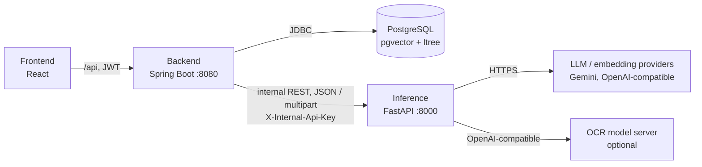
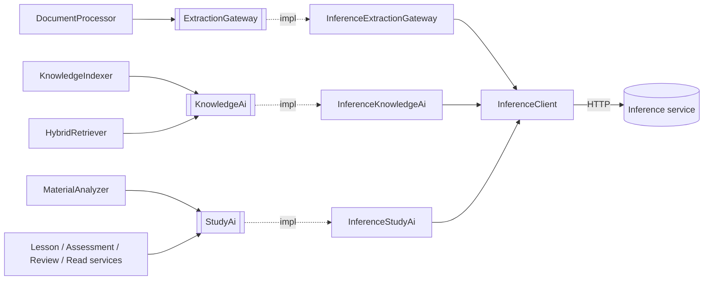
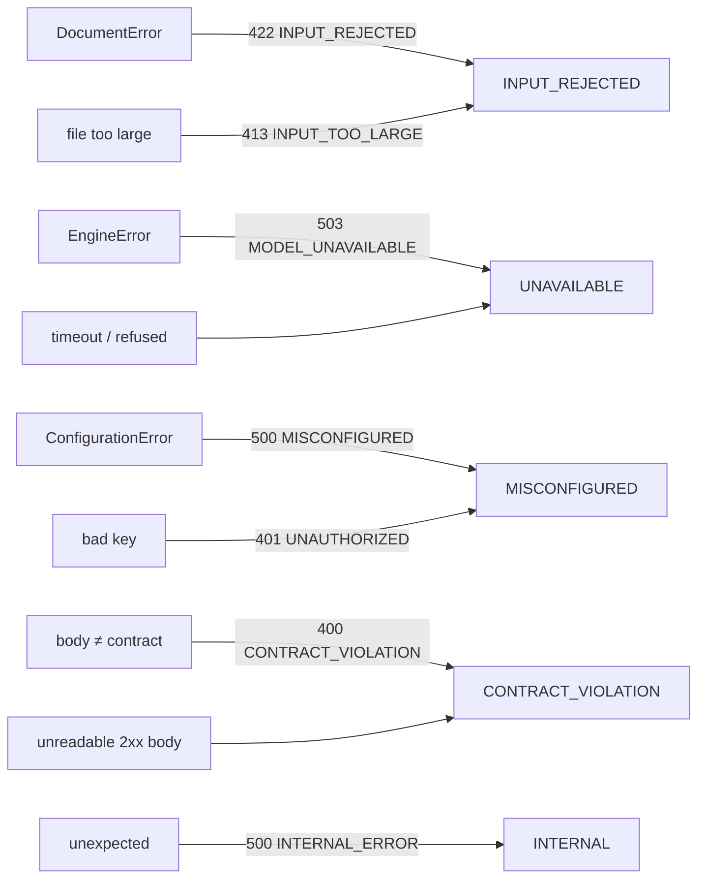

# Backend ↔ inference integration

How the Java backend and the Python inference service connect: ports and adapters, the HTTP contract, the
provider-agnostic LLM layer behind it, and how failures cross the boundary.

Code: `backend/.../common/inference`, `backend/.../document/extraction`, `backend/.../knowledge/ai`,
`backend/.../study/ai`, `backend/.../document/processing`, `inference/src/ved_inference/{main.py,api,llm,config.py}`,
`inference/settings.yaml`

Related: [overview](overview.md), [spec: inference API](../specs/inference-api.md),
[ADR-0001](../adr/0001-polyglot-three-service-architecture.md), [ADR-0006](../adr/0006-llm-behind-a-provider-agnostic-port.md),
[ADR-0011](../adr/0011-contract-first-service-boundary.md),
[document-parsing.md](document-parsing.md), [retrieval.md](retrieval.md), [configuration guide](../guides/configuration.md).

## Topology



- The backend owns all state, users and rules; the inference service is **stateless** (no database, no user
  concept) and only reachable by the backend.
- Every call is synchronous request/response. Queueing, retries across time and persistence of partial results
  are the backend's job.

## Java side: ports and adapters

Domain code depends only on ports (interfaces with domain records). One adapter per port talks HTTP through the
shared `InferenceClient`. No use-case knows about HTTP, JSON field names, or which vendor/model runs.



| Port | Package | Methods | Exception |
|---|---|---|---|
| `ExtractionGateway` | `document.extraction` | `extract(ExtractionRequest)` | `ExtractionException` (checked, `isTransient()`) |
| `KnowledgeAi` | `knowledge.ai` | `describeFigures`, `summarize`, `embed(EmbedTask, items)` | `KnowledgeAiException` (an `AiException`) |
| `StudyAi` | `study.ai` | `buildMaterial`, `generateLesson`, `generateQuestions`, `grade`, `assessmentFeedback`, `answer`, `notes` | `StudyAiException` (an `AiException`) |

`common.ai.AiException` is the technology-neutral base of AI port failures: `isInputRejected()`, `isRetryable()`,
`retryAfter()`. Features never see HTTP status codes or vendor errors.

Adapters keep wire DTOs private (`InferenceExtractionGateway.ExtractResponse`, `InferenceKnowledgeAi.EmbedRequest`, …)
and translate them to domain records (base64 ↔ `byte[]`, keys ↔ ids). `StudyAi` records are serialised as-is, so
they **are** the wire contract and must not reference domain types. Retrieved context is converted to the port's own
records before it is sent: `StudyAi.sources(List<ContextAssembler.Section>)` → `StudyAi.Source(id, path, pages,
summary, passages)` and `StudyAi.figures(List<ContextAssembler.Figure>)` → `StudyAi.SourceFigure(id, sectionId,
caption, description)`. (Before, the specs carried `ContextAssembler` records with internal `nodeId` / `figureId`
and `label` / `title` fields that the service silently dropped; the contract test caught it.)

### `InferenceClient` (shared)

| Concern | Implementation |
|---|---|
| Transport | Spring `RestClient` on the JDK `HttpClient`, HTTP/1.1 |
| Base URL | `ved.inference.base-url` (`VED_INFERENCE_URL`, default `http://localhost:8000`) |
| Auth | default header `X-Internal-Api-Key: ved.inference.api-key` (`VED_INFERENCE_API_KEY`) |
| Timeouts | `connect-timeout: 5s`, `read-timeout: 20m` (OCR of a long scan and large generations are slow) |
| Methods | `getJson`, `postJson`, `postMultipart` |
| Correlation | request interceptor sets `X-Request-Id` from the MDC (see [Request correlation](#request-correlation)) |
| Errors | decodes the error envelope into a typed `InferenceException` (see [Error propagation](#error-propagation)); logs user-safe failures at WARN, operator-facing ones at ERROR, with code and request id |

## Endpoint catalogue

| Endpoint | Caller (port → adapter method) | Inference handler | LLM task |
|---|---|---|---|
| `GET /health` (open) | `InferenceCompatibilityCheck` at startup | `routes.health` | none |
| `POST /v1/extract` (multipart `file`) | `ExtractionGateway.extract` | `routes.extract` → `DocumentParser.parse` (thread pool) | none (OCR engine) |
| `POST /v1/index/figures` | `KnowledgeAi.describeFigures` | `IndexingService.describe_figures` | `figures` (vision) |
| `POST /v1/index/summaries` | `KnowledgeAi.summarize` | `IndexingService.summarize` | `summaries` |
| `POST /v1/index/embed` | `KnowledgeAi.embed` (indexing: `RETRIEVAL_DOCUMENT`; search: `RETRIEVAL_QUERY`) | `IndexingService.embed` | embedder |
| `POST /v1/study/material` | `StudyAi.buildMaterial` | `StudyService.build_material` | `outline` |
| `POST /v1/study/lesson` | `StudyAi.generateLesson` | `StudyService.lesson` | `lesson` |
| `POST /v1/study/questions` | `StudyAi.generateQuestions` | `StudyService.questions` | `questions` |
| `POST /v1/study/grade` | `StudyAi.grade` | `StudyService.grade` | `grade` |
| `POST /v1/study/assessment-feedback` | `StudyAi.assessmentFeedback` | `StudyService.assessment_feedback` | `feedback` |
| `POST /v1/study/answer` | `StudyAi.answer` (tutor + ask) | `StudyService.answer` | `answer` |
| `POST /v1/study/notes` | `StudyAi.notes` | `StudyService.notes` | `notes` |

All JSON is camelCase on the wire (`ApiModel` uses a camelCase alias generator). Request/response shapes:
[inference-api.md](../specs/inference-api.md).

## Inference side

### App composition

`main.create_app` is the composition root (tests pass fake factories). The FastAPI `lifespan` builds everything
once from `Settings` and stores it on `app.state`:

| `app.state` | Built by |
|---|---|
| `parser` | `DocumentParser(build_engine(settings), settings.parsing)` |
| `llm` | `registry.build_llm` → `RoutedLlm` |
| `embedder` | `registry.build_embedder` → `RoutedEmbedder` |
| `study_service` | `StudyService(llm, settings.study)` |
| `indexing_service` | `IndexingService(llm, embedder, settings.indexing)` |

Routers: `routes` (`/health`, `/v1/extract`), `study_routes` (`/v1/study`), `index_routes` (`/v1/index`). The latter
two declare `dependencies=[Depends(require_internal_api_key)]` router-wide; `/v1/extract` declares it per route.
`create_app` also installs the error handlers (`api.errors.install_error_handlers`, the only place error bodies are
built) and `observability.RequestIdMiddleware`, and configures `ved_inference.*` logging with the request id.

### Provider-agnostic LLM layer

```
use-case ──generate(system, prompt, schema, task=…)──► RoutedLlm ──route(task).chain()──► Provider.generate(ModelRef, …)
                                                                     primary, fallback 1, …   GeminiProvider | OpenAICompatibleProvider
```

- **`LlmClient.generate(*, system, prompt, schema, temperature, images, task)`** returns an instance of the Pydantic
  `schema` or raises `EngineError`. `model_name` reports the `provider:model` that served the last call (returned to
  the backend as `model`).
- **Routing**: `LlmConfig.route(task)` = `llm.tasks.<task>` if configured, else `llm.default`. `Route.chain()` =
  primary + fallbacks, which may span providers. `RoutedLlm` tries each `ModelRef` in order; a `ModelUnavailable`
  moves on, exhaustion raises `EngineError("The AI service is busy or out of quota…")`.
- **Tasks in use**: `outline`, `lesson`, `questions`, `grade`, `feedback`, `answer`, `notes` (study), `figures`,
  `summaries` (indexing). In the shipped `settings.yaml` only `summaries` has its own route (lighter model first).
- **Providers** (`llm/providers`): `gemini` (`generateContent`, multimodal embeddings) and `openai` (any
  OpenAI-compatible API: OpenAI, gateways, vLLM, Ollama…). `registry.build_provider` is the only place that knows
  vendors; `build_llm` instantiates just the providers referenced by some route.
- **Structured output**: `json_schema.response_schema` turns the Pydantic model into a self-contained JSON Schema
  (`$ref`s inlined, `title`/`default` dropped). Gemini gets `responseMimeType: application/json` +
  `responseJsonSchema`; OpenAI-compatible gets `response_format: json_schema` (strict) or, with `json_mode: object`,
  `json_object` plus the schema in the prompt. Unparseable or empty output is retryable.
- **Embeddings**: `RoutedEmbedder` uses `settings.embeddings` (one provider/model, no fallback chain: switching
  models changes the vector space). It batches by `batch_size`, drops images when the provider is not multimodal
  (figures then embed from caption + description), and verifies every vector has `dimensions` entries.

### Retries and fallback (`llm/retry.py`)

| Provider response | Raised | Effect |
|---|---|---|
| 429, 500, 502, 503, 504, network error, invalid/empty output | `Retryable(delay)` | retried up to `max_retries` (4) per model |
| server hint (`Retry-After` header or `google.rpc.RetryInfo.retryDelay`) | delay used, capped at `max_backoff_seconds` (45) | no hint → `2^n` s backoff |
| hint > 2 × `max_backoff_seconds` (e.g. daily quota "retry in 17 h") | `ModelUnavailable` immediately | next model in the chain, no pointless waiting |
| OpenAI `429 insufficient_quota`, HTTP 404 (unknown model) | `ModelUnavailable` | next model |
| other 4xx (bad request, auth) | `ConfigurationError` | fails on any model → HTTP 500 `MISCONFIGURED` |

`ModelUnavailable.retry_after` keeps the provider's quota-reset hint. When the whole chain fails, `RoutedLlm` raises
`EngineError` with `retry_after` = the earliest reset, but only if every model gave one (otherwise none: an
unhinted model may recover sooner). The response then carries `Retry-After`.

## Error propagation

Wire format and code table: [inference-api.md § Errors](../specs/inference-api.md#errors).



`InferenceClient` turns every failure into `InferenceException` with a `Kind` (right-hand boxes), the wire `code()`,
`isRetryable()`, `retryAfter()` (from the `Retry-After` header) and `requestId()`:

| Failure | `Kind` | Retryable |
|---|---|---|
| envelope `INPUT_REJECTED` / `INPUT_TOO_LARGE` | `INPUT_REJECTED` | as sent (no) |
| envelope `MODEL_UNAVAILABLE` | `UNAVAILABLE` | as sent (yes) |
| envelope `MISCONFIGURED` / `UNAUTHORIZED` | `MISCONFIGURED` | no |
| envelope `CONTRACT_VIOLATION` / `NOT_FOUND` / `METHOD_NOT_ALLOWED`; 2xx body unreadable or empty | `CONTRACT_VIOLATION` | no |
| envelope `INTERNAL_ERROR` | `INTERNAL` | no |
| no envelope (a proxy answered): by status 413/422 · 429/502/503/504 · 401/403 · 400/404/405 · other | `INPUT_REJECTED` · `UNAVAILABLE` · `MISCONFIGURED` · `CONTRACT_VIOLATION` · `INTERNAL` | `UNAVAILABLE` only |
| connection refused, timeout, reset | `UNAVAILABLE` | yes |

`userMessage(fallback)` returns the service's message only for `INPUT_REJECTED` and `UNAVAILABLE`; for the other
kinds (missing keys, schema errors) it returns the caller's generic fallback, so operator details never reach
learners. This replaces the former boolean `isClientError()`, which treated every 4xx as "document rejected"
(including a 401 from a wrong internal API key).

| Backend adapter | Input rejected | Anything else |
|---|---|---|
| `InferenceExtractionGateway` | `ExtractionException("Document could not be processed: …")`, permanent | `ExtractionException(userMessage("Text extraction is unavailable right now"))`, transient, with `retryAfter` |
| `InferenceKnowledgeAi` | `KnowledgeAiException(message, inputRejected = true)` | `KnowledgeAiException(userMessage(generic), retryable, retryAfter)` |
| `InferenceStudyAi` | `StudyAiException(message, inputRejected = true)` | `StudyAiException(userMessage(generic), retryable, retryAfter)` |

Where it ends up:

- **Pipeline** (`DocumentProcessor`, async): `ExtractionException`, `IndexingException` (`KnowledgeIndexer`) and
  `AnalysisException` (`MaterialAnalyzer`) share the base `document.PipelineException` (`isTransient()`,
  `retryAfter()`); the processor catches it once and marks the document `FAILED`. Background rule: **anything except
  rejected input is transient** (busy, quota, or a misconfiguration an operator will fix) and schedules an automatic
  retry after `ved.documents.processing.auto-retry-delays` (`1m, 4m, 15m`), but never before the retry hint
  (capped at 24 h): a daily quota exhaustion no longer burns all three retries in 20 minutes. Due retries are picked
  up by `DocumentProcessingTriggers.resumeDueRetries`; stages are resumable, so a retry continues where it stopped.
- **Requests** (lesson, grade, ask, notes…): `GlobalExceptionHandler.handleAi` renders any `AiException` as
  **422 `AI_INPUT_REJECTED`** when the input was refused, else **503 `AI_UNAVAILABLE`**, with `Retry-After` when
  known ([api-conventions.md](../specs/api-conventions.md)). Exception: during search, a failing query embedding is
  swallowed and search degrades to keyword-only ([retrieval.md](retrieval.md)).

## Request correlation

One id follows a learner action through both services:

1. `common.web.RequestIdFilter` (first filter) adopts the caller's `X-Request-Id` if it matches
   `[A-Za-z0-9._:-]{1,128}`, else generates one; puts it in the MDC (`requestId`) and the response header.
2. The backend log pattern prints it (`logging.pattern.level: "%5p [%X{requestId:-}]"`); `ApiError.requestId`
   echoes it; the frontend shows its first 8 characters as "(ref …)" on `INTERNAL_ERROR`.
3. `InferenceClient` forwards it as `X-Request-Id`; the inference `RequestIdMiddleware` (pure ASGI) adopts it, logs it
   on every `ved_inference.*` line and echoes it in error bodies.
4. Document jobs inherit the id of the upload that queued them (`RequestId.propagatingDecorator()` on the worker
   pool); jobs started by the scheduler (retries, resumes) log as `doc-<first 8 chars of the document id>`.

## Contract tests

`contracts/inference-openapi.json` is generated from the FastAPI app and committed. `inference/tests/test_contract.py`
fails when it differs from the code; `backend/src/test/java/com/ved/common/inference/InferenceContractTest.java` checks
every backend call (endpoint list in `CALLS`) against it: sent fields exist and required ones are sent, read fields
exist, enums are compatible in the direction they flow, types match, the error envelope matches
`InferenceClient.ErrorBody`, and the contract major equals `InferenceCompatibilityCheck.CONTRACT_MAJOR`. Details and
the regenerate command: [inference-api.md § Contract file](../specs/inference-api.md#contract-file).

## Startup checks

- Inference: `Settings` validation rejects routes that reference unknown providers; a Gemini provider without its
  key fails at construction.
- Backend: `common.inference.InferenceCompatibilityCheck` (on `ApplicationReadyEvent`, virtual thread, non-blocking;
  formerly `knowledge.ai.EmbeddingCompatibilityCheck`) calls `/health` and logs an **error** if the contract major of
  `contractVersion` differs from `CONTRACT_MAJOR` or `embeddingDimensions` ≠ 768 (the `vector(768)` columns),
  otherwise logs contract and model. If the inference service is not up yet, it only logs that the check was skipped.

## Timeouts and concurrency

| Limit | Value | Where |
|---|---|---|
| Connect / read timeout (backend → inference) | 5 s / 20 min | `ved.inference.*` |
| Provider HTTP timeout (inference → LLM) | 180 s | `providers.<name>.timeout_seconds` |
| Remote OCR timeout | 1200 s | `ocr.remote` (`timeout_seconds` default) |
| Document worker pool | core 2, max 4, queue 200, **per instance** | `ved.documents.processing` (`documentProcessingExecutor`) |

The worker pool caps concurrent **pipeline** calls (extraction, indexing, analysis, and background re-embedding via
`KnowledgeIndexer.onStaleEmbeddings`, which runs on the same executor). Interactive calls (lessons, answers, grading)
run on request threads (virtual threads) and are not capped by the pool. On the inference side, sync endpoints run
in FastAPI's thread pool and `/v1/extract` offloads parsing with `run_in_threadpool`; `parsing.max_concurrency`
(default 1, a semaphore in `DocumentParser`) limits concurrent parses, so a single GPU is never shared.

## Security

- Shared secret: `X-Internal-Api-Key` compared with `secrets.compare_digest` against `VED_INFERENCE_API_KEY`
  (`Settings.api_key`). Missing/wrong → 401. `/health` is open. If the key is configured empty, the check is
  **disabled**: never do that outside local development. Both sides default to `dev-internal-key`; override it.
- Not public: browsers never call the service; run it on a private network (uvicorn binds `127.0.0.1` by default).
- Vendor keys live only in the inference environment (`api_key_env` names the variable, `inference/.env`, gitignored);
  the backend never sees them.
- LLM output is untrusted: the inference service validates ids, citations and figure embeds before returning, and the
  backend re-checks references against its own data.

## Adding a new AI capability end-to-end

1. **Inference schemas**: request/response Pydantic models (`ApiModel`, camelCase) in `api/study_schemas.py` or
   `api/index_schemas.py`; the LLM output model in `study/models.py` (or `indexing/models.py`).
2. **Use-case**: a method on `StudyService` / `IndexingService` that calls `self._llm.generate(..., schema=…,
   task="<new-task>")` and validates everything the model returns. Raise `DocumentError` for bad input (422),
   `EngineError` for unavailability (503), `ConfigurationError` for what an operator must fix (500).
3. **Route**: `@router.post("/<name>")` in `study_routes.py` / `index_routes.py`, calling the use-case directly: no
   `try`/`except`, `api/errors.py` renders failures (auth and the documented `ERROR_RESPONSES` come from the router).
4. **Task route** (optional): `llm.tasks.<new-task>` in `inference/settings.yaml` for a different model chain; else
   `llm.default` applies. Add the task name to the comment list there.
5. **Tests**: `inference/tests` with the fake LLM (`tests/fakes.py`).
6. **Contract**: `.venv/bin/python scripts/export_openapi.py` (from `inference/`) and commit
   `contracts/inference-openapi.json`; bump `CONTRACT_VERSION` (minor for additive, major for breaking).
7. **Backend port**: a method + records on `StudyAi` / `KnowledgeAi` (the port's own wire records, no domain or DB
   types, no HTTP), implemented in the adapter (`InferenceStudyAi` / `InferenceKnowledgeAi`) via
   `post("/v1/…", body, Type.class)`; add the call to `InferenceContractTest.CALLS`; update the test fake
   (`backend/src/test/java/com/ved/FakeAi.java`).
8. **Docs**: endpoint, shapes and guarantees in [inference-api.md](../specs/inference-api.md); budgets or settings
   in [configuration.md](../guides/configuration.md).
