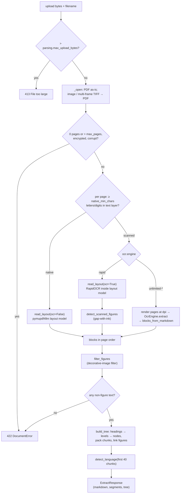

# Document parsing: from upload to document tree

How the inference service turns an uploaded PDF or image into a structured tree (nodes → leaf chunks → figures) in one call to `POST /v1/extract`.

Code: `inference/src/ved_inference/parsing/` (`parser.py`, `layout.py`, `tree.py`, `figures.py`, `models.py`, `language.py`),
`inference/src/ved_inference/engines/`, `inference/src/ved_inference/api/routes.py`, `inference/src/ved_inference/config.py`,
`inference/settings.yaml`

Requirements live in the [knowledge spec](../specs/knowledge.md) (KN-1 to KN-3) and [ADR-0009](../adr/0009-knowledge-store-tree-hybrid-index-figures.md);
OCR engine choice in [ADR-0003](../adr/0003-pluggable-ocr-engines-in-a-python-service.md) and [guides/ocr-engines.md](../guides/ocr-engines.md).
What happens to the result in Postgres: [knowledge-storage.md](knowledge-storage.md). How the backend calls this endpoint:
[backend-inference-integration.md](backend-inference-integration.md).

## Pipeline



Parsing is blocking and runs in a thread pool (`run_in_threadpool`). A `BoundedSemaphore(parsing.max_concurrency)` caps
concurrent parses per process (keep `1` on a single GPU).

## Inputs and limits

| Check | Where | Result |
|---|---|---|
| Size > `parsing.max_upload_bytes` (25 MiB) | `api/routes.py` | 413 `INPUT_TOO_LARGE` |
| Empty file, unsupported extension, corrupt file, password-protected PDF | `DocumentParser._open` | 422 `INPUT_REJECTED` (`DocumentError`) |
| 0 pages, or more than `parsing.max_pages` (200) | `DocumentParser.parse` | 422 |
| No readable text after parsing | `DocumentParser.parse` | 422 `No readable text was found in this document` |
| OCR engine / model server failure | engines | 503 `MODEL_UNAVAILABLE` (`EngineError`) |
| Local OCR extra not installed | `engines/unlimited_local.py` | 500 `MISCONFIGURED` (`ConfigurationError`) |

Accepted: PDF (by `.pdf` extension or a `%PDF-` header) and images `.png .jpg .jpeg .webp .tif .tiff .bmp` (or no
extension). Images, including multi-frame TIFFs, are converted to a PDF with `convert_to_pdf()`, so every input takes
the same path.

## Native text vs OCR, per page

A page is **native** when its PyMuPDF text layer has at least `parsing.native_min_chars` (50) letters or digits
(`\w` matches). Every other page is **scanned** and goes through OCR. Each page in the response's `segments` carries
`method: "text" | "ocr"`, and `engine` joins what was used (`pymupdf`, `pymupdf+rapidocr-layout`, `unlimited-ocr`, ...).

### Layout model (native pages, and scanned pages with `ocr.engine: rapid`)

`layout.read_layout` calls `pymupdf4llm.to_markdown(doc, pages, page_chunks=True, use_ocr=<scanned>, embed_images=True,
header=False, footer=False, dpi=parsing.dpi)`. For each page it walks `page_boxes` (class, bbox, character span into the
page's markdown) and maps classes to typed `Block`s:

| `page_boxes` class | Block | Notes |
|---|---|---|
| `page-header`, `page-footer`, `footnote-marker` | dropped | running headers/footers never reach the tree |
| `section-header`, `title` | `heading` | level = number of leading `#` (else 1); `*` emphasis stripped |
| `caption` / `table` / `formula` | `caption` / `table` / `formula` | text kept verbatim |
| `picture` | `figure` | embedded data-URI image decoded and re-encoded; leftover text (diagram labels) kept as a `text` block |
| anything else (`text`, `list-item`, ...) | `text` | a single line `# ...` is promoted to a `heading` (overlong ones are demoted again by the tree builder) |

Before mapping, each box's text goes through `layout.inline_html_to_markdown`: the layout model's inline HTML
(`<mark>`/`<b>`/`<strong>` → `**…**`, `<i>`/`<em>` → `*…*`, `<u>`/`<span>`/`<font>`/`<sup>`/`<sub>` dropped, `<br>` →
newline) becomes Markdown and enclosed-letter slide bullet glyphs (U+1F130 to U+1F189) are stripped; code spans and fences are left
untouched. The frontend renderer (`shared/ui/markdown/inlineHtml.ts`) applies the same rules, and also hides HTML
comments (including "picture text" blocks), so text stored before this cleanup displays cleanly too.

Tables are repaired first (`parsing/tables.py`, mirrored by `shared/ui/markdown/tables.ts`), because extraction
wraps long cell text: a `<br>` inside a table row becomes a space (a row must stay on one line); a row with an empty
cell that follows a complete row is the wrapped tail of that row and is merged into it cell by cell; and a table
continued after a page break (same header, separated only by blank lines or `---`) becomes one table. Tables that
genuinely contain empty cells are left as they are. The renderer shows tables full width in a horizontally
scrolling wrapper.

With `embed_images=True` the layout model renders each `picture` region, so raster images and vector drawings both arrive
as images. With `use_ocr=True` pymupdf4llm uses RapidOCR (`rapid` extra: `rapidocr_onnxruntime`) and still returns
headings and captions, but not pictures; `figures.detect_scanned_figures` fills that gap (see below).

### Pluggable OCR engines (`ocr.engine`)

| Engine | Implementation | Output |
|---|---|---|
| `rapid` (default) | `engines/registry.py` returns `None`; the parser uses the layout model with `use_ocr=True` | typed blocks with bboxes, figures via gap-with-ink |
| `unlimited-remote` | `UnlimitedOcrRemoteEngine`: OpenAI-compatible `/chat/completions` (SGLang/vLLM serving `baidu/Unlimited-OCR`), `ocr.remote.pages_per_request` pages per request | markdown per batch |
| `unlimited-local` | `UnlimitedOcrLocalEngine`: in-process transformers model (`local` extra, NVIDIA GPU ~8 GB+) | markdown per batch |

Model engines receive pages rendered at `parsing.dpi`; their markdown has detection markup stripped
(`engines/markdown.remove_detection_markup`, `image` regions dropped) and is split into blocks by
`layout.blocks_from_markdown`: `#` paragraphs → `heading`, `|...` → `table`, `$$...` → `formula`, rest → `text`. These
blocks have no bboxes and no figures.

## Tree building (`parsing/tree.py`)

1. **Noise demotion.** A heading longer than `parsing.max_heading_chars` (120) becomes `text`; one that matches the
   caption pattern (`Fig./Figure/Table/Diagram/Chart/Image` + digit) becomes `caption`.
2. **No headings left?** Fallback: one node per `parsing.pages_per_fallback_node` (5) pages, titled `Pages 1–5`,
   `Page 11`, ... (empty page groups are skipped).
3. **Level normalisation.** Distinct layout levels are ranked to 1..n. Explicit numbering then overrides them, but only
   when at least `max(2, headings/2)` headings are numbered:
   - unit headings (`chapter|unit|module|lecture|part|section|lesson|week|topic` + arabic or roman number) → level 1;
   - numbered headings `2`, `2.3`, `2.3.1`, `2.3.1.4` (up to four components) → number of components;
   - when unit headings **and** bare-number headings (`1 Basics`) coexist, numbered levels shift one deeper
     (`Unit 1 → 1 Basics → 1.1 Cells` = levels 1, 2, 3).
   - every level is clamped to `1..parsing.max_depth` (4).
4. **Introduction node.** Content before the first heading gets a level-1 node titled `Introduction`.
5. **Assembly.** A stack attaches each heading to the nearest shallower ancestor (a jump 1 → 3 attaches to the level-1
   node). Each node gets:
   - `path`: ordinal position among siblings (`2.3.1`), stored as an `ltree` by the backend;
   - `label`: the document's own numbering (`Unit 4`, `Chapter 2`, `2.3`) or, without one, the path;
   - `title`: the heading with its numbering removed (`2.3 Osmosis` → `Osmosis`, `Chapter 2: Energy` → `Energy`);
   - `level` (depth in the built tree), `ordinal` (pre-order position), `page_from/page_to`, widened so a parent spans
     all its children's pages.

The PDF outline (bookmarks) is not used; levels come only from the layout model and numbering.

## Leaf chunks

Blocks of each node are packed into chunks in reading order (`_pack`):

- flush the buffer before a block when it would exceed `parsing.chunk_max_chars` (1400), or when the buffer has already
  reached `parsing.chunk_target_chars` (900) and the block is not a table/formula;
- `table` and `formula` blocks are atomic: never split, and a single one larger than the target closes its own chunk
  (so a chunk can exceed the max when one table does);
- a `caption` never triggers a flush, so it always stays in the chunk of the figure it describes;
- chunks never span nodes; each records `page_from/page_to` of the blocks it holds.

## Figures

**Extraction.** Native pages: `picture` boxes from the layout model (raster images and vector diagrams alike). Scanned
pages (`rapid`): `detect_scanned_figures` renders the page in greyscale at 72 dpi (1 px = 1 pt), masks every text
block's bbox, ignores 5 % side margins, and finds horizontal bands where > 2 % of a row is ink (grey < 160), merging
gaps of ≤ 8 rows. Bands ≥ 60 pt tall and larger than `min_page_area_fraction` of the page are cropped (4 pt padding),
rendered at `parsing.dpi`, and inserted into the reading order by vertical position.

**Encoding** (`figures.encode`): downscaled to `figures.max_side_px` (1600); PNG for line art (palette/alpha modes or
≤ 512 colours), otherwise JPEG quality 85.

**Decorative-image filter** (`figures.filter_figures`, whole document, after all pages are read):

| Rule | Setting (default) | Purpose |
|---|---|---|
| Same 8×8 average hash on ≥ N distinct pages **and** largest copy < fraction of page | `repeat_pages` (3), `logo_max_area_fraction` (0.08) | logos, watermarks, page ornaments (several copies on one page are kept) |
| Same hash again within one section (a heading starts a new section) | — | larger repeated images are reused content (e.g. an architecture diagram on every slide that discusses it): kept once per section |
| Short side < N px | `min_side_px` (100) | icons, bullets, tiny glyph images |
| Long/short side > N | `max_aspect` (6.0) | rules, borders, banners |
| bbox area < fraction of page | `min_page_area_fraction` (0.012) | small decorations (needs a bbox) |
| bbox area > fraction of page on a native page | `background_area_fraction` (0.85) | full-page backgrounds behind text |
| More than N kept figures | `max_figures` (400) | bounds storage and vision-description cost |

A second, semantic filter runs later in the backend: the vision model gives each figure a role; `DECORATIVE` figures are
deleted and `TEXTUAL` ones (terminal output, code) are replaced by a text transcript
([knowledge-storage.md](knowledge-storage.md#indexing-stages)).

**Linking.** Each figure belongs to the node it appears in. Its caption is the first `caption` block (or short
`Figure 3 …`-style text) at position +1, +2 or −1. Its anchor `chunkKey` is the chunk being built when the figure
appears, else the previous chunk of the node, else the node's first chunk (or `null` for a node without text).

## Language detection

`language.detect_language` reads the first 40 chunks (≤ 20,000 chars) and returns an ISO 639-1 code (`en es fr de pt
it`) by stopword hits, or `und` when there are fewer than 20 words, more than 30 % non-ASCII words (e.g. Devanagari), or
the best language scores below 5 % of words. The backend maps it to a Postgres text-search configuration.

## Output contract (`POST /v1/extract`, camelCase)

```jsonc
{
  "markdown": "...",            // all pages joined with "\n\n---\n\n" (figures as *[Figure]*)
  "engine": "pymupdf+rapidocr-layout", "language": "en",
  "pageCount": 3, "textPages": 2, "ocrPages": 1,
  "segments": [{"pageFrom": 1, "pageTo": 1, "method": "text", "markdown": "# The Cell ..."}],
  "tree": {
    "nodes":   [{"key": "n1", "parentKey": null, "level": 1, "path": "1", "label": "Chapter 1",
                 "title": "The Cell", "ordinal": 1, "pageFrom": 1, "pageTo": 2}],
    "chunks":  [{"key": "c1", "nodeKey": "n1", "ordinal": 1, "text": "...", "pageFrom": 1, "pageTo": 1}],
    "figures": [{"key": "f1", "nodeKey": "n2", "chunkKey": "c2", "ordinal": 1, "page": 1,
                 "bbox": [72.0, 140.5, 520.0, 410.0], "caption": "Figure 1.1: A typical plant cell",
                 "mime": "image/png", "width": 900, "height": 540, "imageBase64": "..."}]
  }
}
```

Keys (`n*`, `c*`, `f*`) are only valid within one response; the backend replaces them with UUIDs. Nodes are in
pre-order, so a parent always precedes its children. Schemas: `api/schemas.py`.

## Tuning knobs (`inference/settings.yaml`)

Override any key with `VED_INFERENCE_<SECTION>__<KEY>` (see [guides/configuration.md](../guides/configuration.md)).

| Key | Default | Effect |
|---|---|---|
| `parsing.max_upload_bytes` | 26214400 | larger uploads → 413 |
| `parsing.max_pages` | 200 | longer documents → 422 |
| `parsing.dpi` | 200 (72–400) | rendering resolution for OCR and figure crops |
| `parsing.max_concurrency` | 1 | concurrent parses per process |
| `parsing.native_min_chars` | 50 | letters/digits for a page to skip OCR |
| `parsing.chunk_target_chars` | 900 | chunk closes once it reaches this (~150–250 tokens) |
| `parsing.chunk_max_chars` | 1400 | hard ceiling unless one table/formula is bigger |
| `parsing.max_depth` | 4 | deepest heading level kept |
| `parsing.max_heading_chars` | 120 | longer "headings" become text |
| `parsing.pages_per_fallback_node` | 5 | node size when a document has no headings |
| `parsing.figures.max_side_px` | 1600 | figure downscale target |
| `parsing.figures.min_side_px` | 100 | smaller figures dropped |
| `parsing.figures.min_page_area_fraction` | 0.012 | smaller figures dropped; also min size of scanned-page figures |
| `parsing.figures.max_aspect` | 6.0 | more elongated figures dropped |
| `parsing.figures.repeat_pages` | 3 | small repeated images (logos) dropped |
| `parsing.figures.logo_max_area_fraction` | 0.08 | repeated images at least this large are kept once per section |
| `parsing.figures.background_area_fraction` | 0.85 | page-sized images on text pages dropped |
| `parsing.figures.max_figures` | 400 | cap per document |
| `ocr.engine` | `rapid` | `rapid` / `unlimited-remote` / `unlimited-local` |
| `ocr.remote.base_url`, `model`, `flavor`, `pages_per_request` | `http://localhost:10000/v1`, `Unlimited-OCR`, `sglang`, 8 | remote model server |
| `ocr.local.model_id`, `device` | `baidu/Unlimited-OCR`, `cuda` | in-process model |

## How to extend

**Add an OCR engine.** Subclass `engines.base.OcrEngine` (`name`, `extract(pages) -> EngineOutput`, optional
`close()`), return markdown per page run and raise `EngineError` with a user-safe message on failure. Add the name to
`EngineName` in `config.py` and a lazy-import factory to `ENGINE_FACTORIES` in `engines/registry.py`; put heavy
dependencies in a `pyproject.toml` extra. Test it against a mock HTTP transport like `tests/test_unlimited_remote.py`.
Engines returning `None` (like `rapid`) mean "use the layout model's OCR".

**Tweak heading rules.** All rules are in `parsing/tree.py`: `_UNIT` (unit keywords), `_NUMBERED` (numbering depth),
`_CAPTION` (what is never a heading), `_normalised_levels` (when numbering wins and the unit shift),
`_clean_title`. Add a case to `tests/test_tree.py` for every rule change; it builds trees from hand-written blocks, so no
PDF is needed.

**Change block mapping.** `layout._blocks_from_chunk` is the only place that knows pymupdf4llm's box classes.

## Tests as executable documentation

| Test | Shows |
|---|---|
| `tests/test_tree.py` | numbering vs font levels, unit shift, `Introduction` node, page-group fallback, noise headings, chunk sizes, caption + figure anchoring, language detection |
| `tests/test_parser.py` | a generated textbook PDF → expected tree; raster + vector figure kept, repeated logo dropped; scanned PDF via layout OCR; model engine path; page limit and corrupt files |
| `tests/test_figures.py` | small repeated image dropped as a logo, large reused figure kept once per section |
| `tests/test_api.py` | `/v1/extract` wire shape (pages + tree + figures), API-key check (401), unreadable file (422) |
| `tests/test_markdown.py`, `tests/test_unlimited_remote.py` | Unlimited-OCR markup cleanup and HTTP contract |

## Known limitations

- PDF outlines (bookmarks) are ignored; heading levels depend on the layout model and on numbering.
- Model OCR engines (`unlimited-*`) yield no figures and no bboxes on scanned pages. All blocks of a batch of
  `pages_per_request` pages are attributed to the batch's first page (the last block to its last page), so per-page
  `segments` of the other pages are empty and chunk page ranges are coarse.
- Gap-with-ink detection only finds full-width horizontal bands; side-by-side figures merge into one, and figures
  touching text bboxes can be cut.
- A table or formula larger than `chunk_max_chars` becomes one oversized chunk.
- Language detection covers six Latin-script languages; everything else is `und` (no stemming).
- The whole document is held in memory and parsed in one request; `max_pages` and `max_upload_bytes` bound it.
