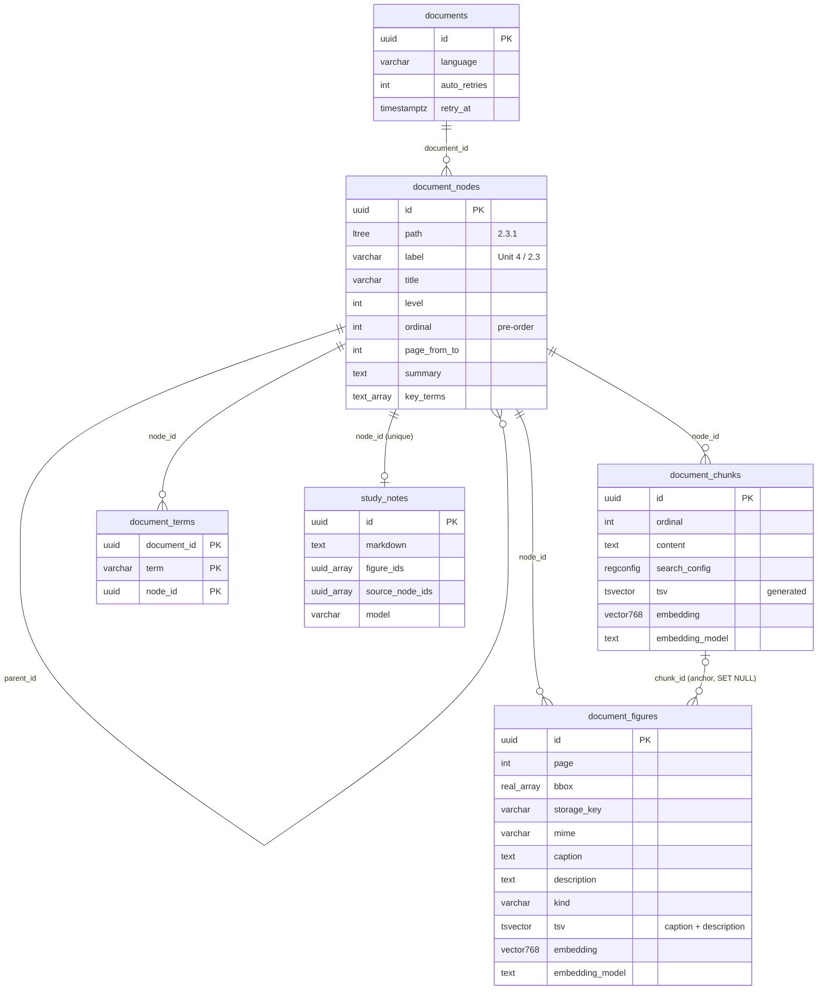
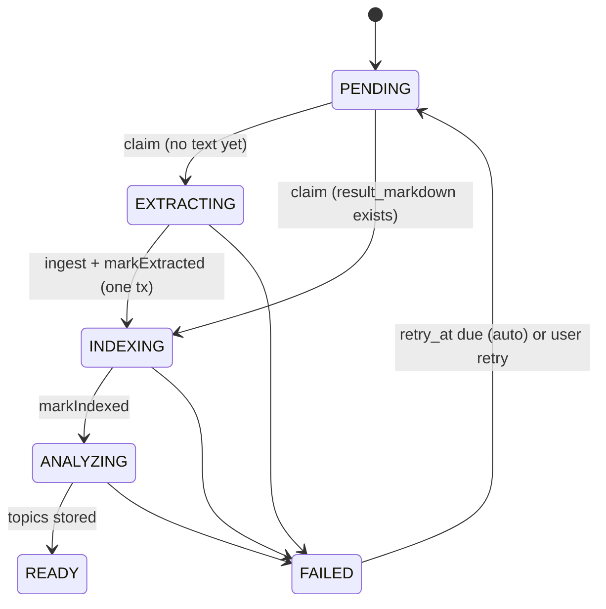

# Knowledge storage: tree, chunks, figures, terms and vectors in PostgreSQL

How the backend stores the parsed document tree, indexes it (figure descriptions, summaries, term index, embeddings)
and keeps it consistent, resumable and access-controlled.

Code: `backend/src/main/java/com/ved/knowledge/` (`KnowledgeIndexer`, `KnowledgeProperties`, `StaleEmbeddingsDetected`,
`store/KnowledgeStore`, `store/SearchConfig`, `figure/*`, `ai/*`, `web/KnowledgeAccess`),
`backend/src/main/java/com/ved/document/processing/` (`DocumentProcessor`, `DocumentProcessingTriggers`),
`backend/src/main/resources/db/migration/V4__knowledge_store.sql`, `V5__document_auto_retry.sql`, `V6__embedding_model.sql`

Requirements and public endpoints: [knowledge spec](../specs/knowledge.md). Decision record:
[ADR-0009](../adr/0009-knowledge-store-tree-hybrid-index-figures.md). Where the tree comes from:
[document-parsing.md](document-parsing.md). How it is searched: [retrieval.md](retrieval.md). How the backend talks to
the inference service: [backend-inference-integration.md](backend-inference-integration.md).

## Schema

Extensions: `ltree` (hierarchical paths) and `vector` (pgvector). Every table cascades from `documents`, so deleting a
document removes its whole knowledge store (figure files are deleted separately, see [Ingest](#ingest)).



### Indexes and why they exist

| Index | Serves |
|---|---|
| `ix_document_nodes_path` GiST on `path` | subtree filters `n.path <@ '2.3'` (scoped search, notes, figures of a section) |
| `UNIQUE (document_id, path)`, `UNIQUE (document_id, ordinal)` on nodes | one node per path; stable pre-order for tree rendering |
| `ix_document_nodes_parent` on `parent_id` | child lookups and the self-referencing cascade |
| `ix_document_chunks_tsv` GIN on `tsv` | keyword search `tsv @@ websearch_to_tsquery(...)` (the inverted index) |
| `ix_document_chunks_embedding` HNSW `vector_cosine_ops` | approximate nearest neighbours by cosine distance `<=>` |
| `ix_document_chunks_node` on `(node_id, ordinal)` | a node's chunks in order; small-to-big neighbour windows |
| `UNIQUE (document_id, ordinal)` on chunks / figures | global reading order per document |
| `ix_document_figures_tsv` GIN, `ix_document_figures_embedding` HNSW cosine | keyword and semantic figure search |
| `ix_document_figures_node` on `(node_id, ordinal)` | figures of a node in order |
| `document_terms` PK `(document_id, term, node_id)` | no duplicate term-node pairs (`ON CONFLICT DO NOTHING`) |
| `ix_document_terms_lookup` on `(document_id, lower(term))` | case-insensitive term-index lookups and ordering |
| `ix_documents_retry_at` partial (`WHERE retry_at IS NOT NULL`) | the retry poller's "due retries" query |

`tsv` columns are `GENERATED ALWAYS ... STORED` from `to_tsvector(search_config, ...)`, so they can never drift from
the text. Persistence is plain JDBC (`KnowledgeStore`) because ltree, pgvector, `regconfig` and generated columns are
outside what JPA maps well; vectors are bound as `'[...]'::vector` literals.

### Language-aware text search

`SearchConfig.forLanguage` maps the document language detected at parse time to a Postgres text-search configuration:
`en → english`, `es → spanish`, `fr → french`, `de → german`, `pt → portuguese`, `it → italian`, anything else
(including `und`) → `simple` (no stemming, no stopwords). It is stored per row in `search_config`, and keyword queries
use the same row's config (`websearch_to_tsquery(c.search_config, ?)`), so query and document are stemmed identically.

## Ingest

`KnowledgeIndexer.ingest` runs inside the extraction transaction of `DocumentProcessor` (`Propagation.MANDATORY`),
together with the `document_segments` rows and `Document.markExtracted`:

1. `deleteTree` collects the old figure `storage_key`s, then deletes terms and nodes (cascading to chunks, figures and
   notes): re-extraction replaces the tree.
2. Each figure image is written to `DocumentStorage` (local disk today: `<storage-dir>/yyyy/mm/dd/<uuid>.png|jpg`).
3. `insertTree` maps response keys (`n1`, `c1`, `f1`) to fresh UUIDs and batch-inserts nodes (pre-order, so parents come
   first), chunks and figures with the document's `search_config`.
4. A `TransactionSynchronization.afterCompletion` keeps disk and database consistent whatever happens: on **commit**
   the old tree's files are deleted; on **rollback** the newly written files are deleted.

The inference call itself happens before this transaction; no slow call runs inside it
([conventions](conventions.md)).

## Pipeline states and retries



- `DocumentProcessor.process` runs on the `documentProcessingExecutor` pool. Each state change is its own short
  transaction; extraction, indexing and analysis calls run outside them.
- Extraction is skipped on a retry when the document already has extracted text (`isTextExtracted()`).
- **Transient failures** (AI provider busy, rate-limited or out of quota: `KnowledgeAiException` during indexing, or a
  transient `ExtractionException` / `AnalysisException`) set `FAILED` with `retry_at = now + delay[auto_retries]` and
  increment `auto_retries`, while retries remain in `ved.documents.processing.auto-retry-delays`. The message tells the
  user progress is saved.
- `DocumentProcessingTriggers.resumeDueRetries` polls every `ved.documents.processing.retry-poll` (default 30s), moves
  due documents back to `PENDING` and resubmits them. A user retry resets `auto_retries`.
- On startup, documents left in `PENDING/EXTRACTING/INDEXING/ANALYZING` are requeued.

## Indexing stages

`KnowledgeIndexer.index` runs four stages in order. Each stage selects only rows still **missing** its data and commits
**per batch** (`TransactionTemplate`), so a retry resumes after the last committed batch.

| # | Stage | Selects | Calls | Writes |
|---|---|---|---|---|
| 1 | Figure descriptions | figures with `description IS NULL` | `describeFigures` (vision; image + caption + breadcrumb), `figure-batch` per call | `description`, `kind`; figures judged **not educational** are deleted, their file removed after commit |
| 2 | Summaries + key terms | nodes with `summary IS NULL`, `ORDER BY level DESC` | `summarize`, `summary-batch` per call, one level at a time | `summary`, `key_terms`; each term → `document_terms` |
| 3 | Chunk embeddings | chunks with `embedding IS NULL`, `chunk-embed-batch` at a time | `embed(RETRIEVAL_DOCUMENT)` on `breadcrumb + "\n" + content` | `embedding`, `embedding_model` |
| 4 | Figure embeddings | figures with `embedding IS NULL AND description IS NOT NULL` | `embed(RETRIEVAL_DOCUMENT)` with image bytes + `caption\ndescription` | `embedding`, `embedding_model` |

Details:

- **Bottom-up summaries**: levels are processed deepest first and the node map is reloaded per level, so a parent's
  input includes its children's fresh summaries (`"<label> <title>: <summary>"`) plus up to `summary-text-chars` of its
  own chunks and its breadcrumb.
- **Breadcrumb** (`ContextAssembler.breadcrumb`): ancestor labels and titles joined with ` › `
  (`Chapter 2 Energy › 2.3 Osmosis`), so a chunk's vector carries its section context.
- **Multimodal figures**: the inference service embeds the image itself when `embeddings.multimodal` is on and the
  provider supports image embeddings, otherwise the caption and description text.
- A description the model did not return is simply left `NULL` and retried on the next run.
- Prompts use the document language (`und` → `en`). Backend batch sizes are per inference call and per commit; the
  inference service splits them further (`indexing.figures_per_call`, `nodes_per_call`).

## Embedding-model tracking

Every vector records the model that produced it in `embedding_model` (`"provider:model"`, e.g.
`gemini:gemini-embedding-2`; V6 back-filled existing rows). Vectors from different models live in different spaces and
are never compared:

1. Vector search (`vectorChunks`, `vectorFigures`) filters `embedding_model = <query's model>`; vectors of other models
   are invisible, and keyword search still covers the document.
2. When a query is embedded, `HybridRetriever` checks `hasStaleEmbeddings` (any vector whose model `IS DISTINCT FROM`
   the query's model) and publishes `StaleEmbeddingsDetected(documentId, model)`.
3. `KnowledgeIndexer.onStaleEmbeddings` (`@Async("documentProcessingExecutor")`, so it shares the worker pool's cap on
   concurrent inference calls) de-duplicates per document, clears stale vectors (`clearStaleEmbeddings`) and reruns
   stages 3 and 4. If the provider is busy, it stops and resumes on the next search.

At startup, `EmbeddingCompatibilityCheck` reads the inference `/health` and logs an error when its
`embeddingDimensions` differ from the schema's 768.

## Figure files and signed URLs

Images live in `DocumentStorage`, never in the database; rows keep `storage_key`, `mime`, `width`, `height`. Clients get
URLs from `FigureUrlSigner.url(figureId)`:

```
/api/figures/{figureId}/image?exp=<epoch seconds>&sig=<base64url(HMAC-SHA256(secret, "<figureId>:<exp>"))>
```

- `exp` = next full hour + `figure-url-ttl`, so the URL is identical for a whole hour and browsers can cache it; a URL
  is valid for between `ttl` and `ttl + 1h`.
- `FigureController` is a public route: it verifies the signature (constant-time compare) and expiry, returns 404 on
  failure, and serves the file with `Cache-Control: private, max-age=3600, immutable` and `X-Content-Type-Options:
  nosniff`. Like S3 presigned URLs, `` works without an `Authorization` header.

## Ownership and access

The knowledge store has no owner column; access goes through the document. `KnowledgeAccess.requireDocument` calls
`DocumentService.get(userId, documentId)` (owner-scoped; someone else's document is **404**) and returns
`RESULT_NOT_READY` while the tree does not exist yet. `requireNode` also checks the node belongs to that document. Figure
URLs are only issued in responses that passed these checks; the signature is the capability.
`KnowledgeFlowIT.otherUsersCannotReadTheKnowledgeStore` covers it.

## Tuning (`backend/src/main/resources/application.yml`)

See [guides/configuration.md](../guides/configuration.md) for env-var overrides.

| Key | Default | Effect |
|---|---|---|
| `ved.knowledge.figure-url-secret` | `${VED_FIGURE_URL_SECRET:dev-only-...}` | HMAC key; **must** be overridden outside dev; changing it invalidates issued URLs |
| `ved.knowledge.figure-url-ttl` | `6h` | validity after hour alignment |
| `ved.knowledge.indexing.figure-batch` | 12 | figures per description call / commit |
| `ved.knowledge.indexing.summary-batch` | 36 | nodes per summary call / commit |
| `ved.knowledge.indexing.chunk-embed-batch` | 96 | chunks per embedding call / commit |
| `ved.knowledge.indexing.figure-embed-batch` | 16 | figures per embedding call / commit |
| `ved.knowledge.indexing.summary-text-chars` | 6000 | own text per node sent for summarising |
| `ved.knowledge.retrieval.*` | `candidates: 30`, `rrf-k: 60`, `figure-min-similarity: 0.48` | search tuning, see [retrieval.md](retrieval.md) |
| `ved.documents.processing.auto-retry-delays` | `1m, 4m, 15m` | one automatic retry per entry; empty disables |
| `ved.documents.processing.retry-poll` | `30s` (code default, not in yml) | how often due retries are checked |
| `ved.documents.processing.core-pool-size` / `max-pool-size` / `queue-capacity` | 2 / 4 / 200 | worker pool shared by processing and re-embedding |

## Tests

| Test | Shows |
|---|---|
| `backend/src/test/java/com/ved/knowledge/KnowledgeFlowIT.java` | tree hierarchy and labels, signed figures in node views, hybrid search with scope, background re-embedding after a model switch, term index, notes caching, access control |
| `backend/src/test/java/com/ved/knowledge/FigureUrlSignerTest.java` | signing, verification, expiry |
| `backend/src/test/java/com/ved/knowledge/retrieval/HybridRetrieverTest.java` | RRF fusion rewards agreement, keeps keyword highlights |
| `backend/src/test/java/com/ved/document/DocumentFlowIT.java` | the document pipeline end to end |

## Known limitations

- `vector(768)` is fixed by the schema (and `EmbeddingCompatibilityCheck.DATABASE_DIMENSIONS`). A model with another
  size needs a migration (new columns or type change, index rebuild) and a full re-embed; set
  `embeddings.dimensions: 768` where the model supports truncation.
- HNSW is approximate and pgvector applies the `document_id` / `embedding_model` / subtree filters after the index scan;
  with many documents a filtered query can return fewer than `candidates` rows. Keyword search and RRF soften this.
- During a model switch, a document's semantic search is partial until re-embedding finishes; it only starts when the
  document is searched.
- Re-extraction replaces the tree with new UUIDs. It only runs while a document has no extracted text, but any ids held
  outside the knowledge tables (topics' `node_ids`, lessons' `figure_ids` are plain UUID arrays, not foreign keys) would
  not follow; notes cascade.
- A figure the vision model never describes is never embedded (stage 4 requires a description); indexing still
  completes.
- One language per document: mixed-language documents are stemmed with a single configuration.
- Figure files are on local disk; `DocumentStorage` is the seam for object storage.
