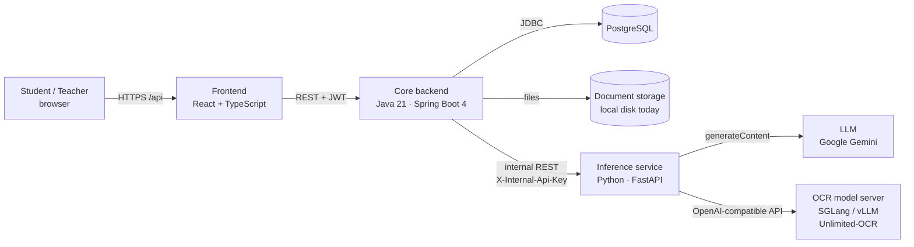
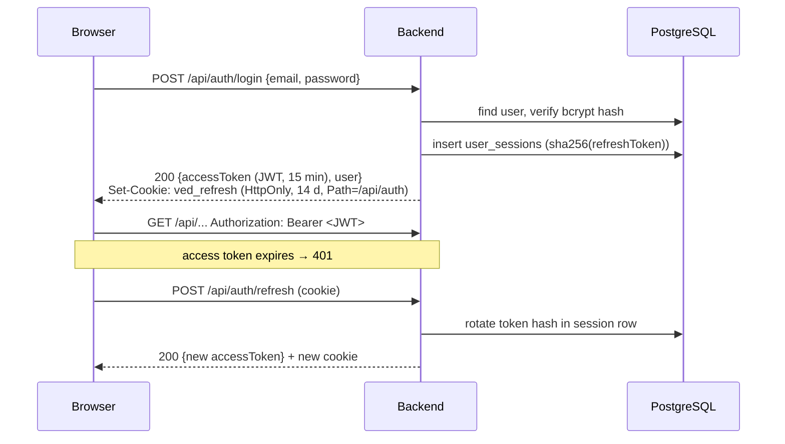
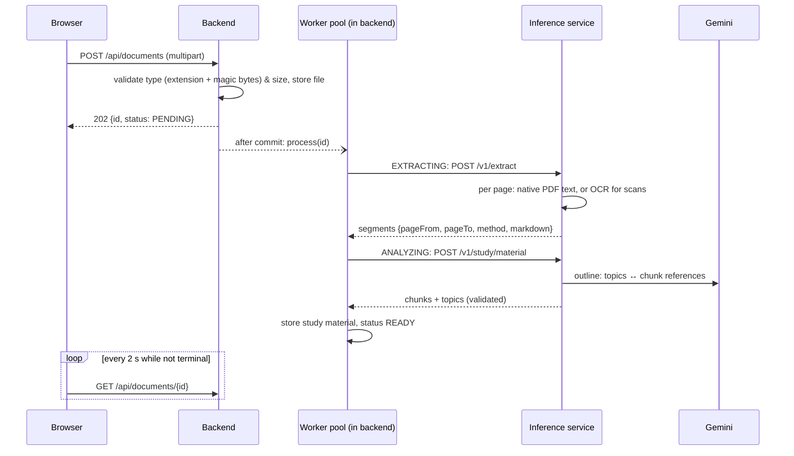
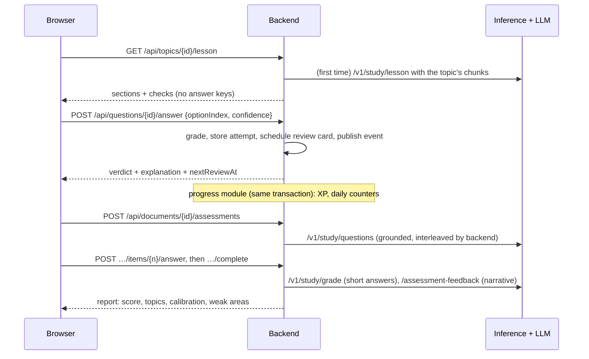

# Architecture overview

Ved turns any educational document into a guided course: Learn mode (AI tutor), Test mode
(grounded assessments), spaced review, progress and analytics. Product and UI decisions follow
[learning-science.md](learning-science.md).

## System context



| Component | Folder | Responsibility | Talks to |
|---|---|---|---|
| Frontend | `frontend/` | UI only. No business rules beyond input hints. | Backend (`/api`) |
| Core backend | `backend/` | **The single source of truth**: identity, authorisation, domain data, grading rules, job orchestration, analytics. | PostgreSQL, storage, inference |
| Inference service | `inference/` | Stateless AI/ML: text extraction (native PDF text + OCR) and LLM-written study content. No database, no user concept. | LLM provider, OCR model servers |

Ground rules:

1. **Only the backend is public.** The inference service is internal and trusts the backend
   (shared API key). Browsers never call it.
2. **Only the backend owns data.** The inference service receives inputs and returns outputs; it
   never stores user data.
3. **The backend owns the rules, the AI writes content.** Answer keys, grading of choice questions,
   XP, scheduling and access control are deterministic backend code; the LLM only drafts lessons,
   questions, short-answer grades and report narratives, which the inference service validates.
4. **Language per job:** Java for business logic, Python for ML, TypeScript for the UI
   ([ADR-0001](../adr/0001-polyglot-three-service-architecture.md)).

## Backend internals

Package-by-feature (`com.ved.<feature>`), with a thin layered structure inside each feature:

```
com.ved
├── common/          error model, request ids, time, pagination, AI port base exception, inference HTTP client
├── security/        JWT issuing/validation, CORS, @CurrentUserId
├── user/            User aggregate (time zone, daily goal), /api/users
├── auth/            register/login/refresh/logout; publishes UserLoggedInEvent
│   └── session/     refresh-token sessions (open / rotate / revoke)
├── document/        upload + processing pipeline (extract → analyze)
│   ├── storage/     DocumentStorage port + local filesystem adapter
│   ├── extraction/  ExtractionGateway port + inference adapter
│   └── processing/  async worker, triggers (after-commit, due retries, lease heartbeat + abandoned-job recovery)
├── study/           Learn & Test on top of a shared study material
├── sharing/         share to Explore (categories, snapshot listing), import as an independent copy
│   ├── ai/          StudyAi port + inference adapter
│   ├── material/    StudyMaterial / chunks / topics, MaterialAnalyzer (implements DocumentAnalyzer),
│   │                MaterialAccess (authorisation + grounded sources), mastery, recommender
│   ├── question/    question bank, grading, attempts, Leitner review cards
│   ├── learn/       lessons, checks, topic progress, tutor
│   ├── assess/      assessments, interleaving, reports
│   ├── review/      spaced-review sessions
│   └── overview/    study hub read model, "next best step"
└── progress/        XP, levels, streaks, daily goal, heartbeats, analytics (event consumer)
```

Dependency direction: `study → document → (DocumentAnalyzer port, implemented by study)`;
`progress → study, auth` (events only); nothing depends on `progress`.

Inside a feature: `Controller → Service → Repository / Port`. Controllers handle HTTP only;
services hold the use-cases and transactions; **ports** (interfaces) wrap anything external
(storage, extraction, AI, token format) so it can be swapped without touching the use-cases. See
[conventions.md](conventions.md).

## Key flows

### Authentication



Details: [specs/auth.md](../specs/auth.md), [ADR-0002](../adr/0002-jwt-access-tokens-with-rotating-refresh-sessions.md).

### Document pipeline: upload → study material



### Learning loop



Details: [specs/study.md](../specs/study.md), [specs/progress.md](../specs/progress.md),
[ADR-0003](../adr/0003-pluggable-ocr-engines-in-a-python-service.md),
[ADR-0004](../adr/0004-in-process-async-document-processing.md),
[ADR-0006](../adr/0006-llm-behind-a-provider-agnostic-port.md),
[ADR-0007](../adr/0007-shared-study-material-content-vs-learner-state.md),
[ADR-0008](../adr/0008-progress-via-in-transaction-domain-events.md),
[ADR-0011](../adr/0011-contract-first-service-boundary.md).

### Service boundary and scaling

- **Contract**: the backend ↔ inference API is the committed `contracts/inference-openapi.json`, tested from both
  sides; every error is a typed envelope (`code`, `message`, `retryable`, `requestId`) and every request carries an
  `X-Request-Id` that appears in both services' logs
  ([backend-inference-integration.md](backend-inference-integration.md), [specs/inference-api.md](../specs/inference-api.md)).
- **Horizontal scaling**: the backend can run as several instances. Document processing is coordinated through the
  database (row-locked claim + heartbeat lease, [knowledge-storage.md](knowledge-storage.md)); there is no broker yet.
  The inference service is stateless and scales independently.

## Data model

| Area | Tables | Spec |
|---|---|---|
| Identity | `users` (+ `time_zone`, `daily_goal_minutes`), `user_sessions` | [auth.md](../specs/auth.md) |
| Documents | `documents`, `document_segments` | [ocr.md](../specs/ocr.md) |
| Study content (shareable) | `study_materials`, `study_chunks`, `study_topics`, `study_lessons`, `study_questions` | [study.md](../specs/study.md) |
| Learner state | `topic_progress`, `question_attempts`, `assessments`, `assessment_items`, `review_cards` | [study.md](../specs/study.md) |
| Analytics | `learning_events`, `user_daily_activity`, `user_presence` | [progress.md](../specs/progress.md) |

Schema changes are **Flyway migrations** in `backend/src/main/resources/db/migration`
(`V<n>__<description>.sql`). Never edit a migration that has run in a shared environment; add a new one.
Hibernate only *validates* the schema (`ddl-auto: validate`).

## Frontend internals

React 19 + TypeScript (strict) + Vite. Plain CSS on design tokens (no CSS framework), `lucide-react`
icons, `motion` for animation, `canvas-confetti` for achievements, `react-markdown` + KaTeX for
AI/OCR content. Design rules: [specs/design-system.md](../specs/design-system.md).

```
src/
├── main.tsx          fonts + global styles (tokens → base → components), then <App/>
├── styles/           tokens.css (light + [data-theme=dark]), base.css, components.css
├── app/              route table (lazy-loaded pages), shell: top bar, bottom nav (mobile), logo
├── shared/           feature-agnostic; never imports from features/
│   ├── api/          fetch wrapper (token, single-flight refresh), ApiError
│   ├── hooks/        usePolling
│   ├── lib/          formatting, downloads, time zone, celebrate (confetti)
│   └── ui/           component kit: Button, Card, Badge, Progress(Bar|Ring), Skeleton, Tabs,
│                     Segmented, Toast, ConfirmButton, EmptyState, Markdown, PageTransition…
└── features/
    ├── theme/        ThemeProvider (light/dark/system), toggle
    ├── auth/         AuthProvider (session), login/register, route guards
    ├── progress/     ProgressProvider (summary + XP/level/goal toasts), heartbeat hook,
    │                 dashboard (next best step, goal ring, activity chart, feed), goal onboarding
    ├── documents/    library (upload, pipeline stepper, retry), extracted-text view
    └── study/        hub (Learn / Test), learn path, lesson (progressive steps, checks, tutor),
                      test setup, assessment runner + report, spaced review; shared QuestionCard
```

| Route | Page |
|---|---|
| `/` | Dashboard: one "next best step", daily goal, streak, level, reviews due, 14-day activity |
| `/welcome` | One-time, skippable daily-goal step (after registration / first login on a device) |
| `/library` | Upload + documents with processing status |
| `/documents/:id` | Study hub: Learn / Test my knowledge, topics, tests, document Preview (reading view, original, raw text) |
| `/documents/:id/learn` | Redirects to `/documents/:id` (the learning path lives in its Topics tab) |
| `/documents/:id/learn/:topicId` | Lesson: warm-up → sections + checks → explain-it-back → takeaways |
| `/documents/:id/test` | Test setup (count, difficulty, topics) |
| `/assessments/:id` | Runner (one question at a time) or report when completed |
| `/review?documentId=` | Spaced-review session |

Conventions:

- A feature owns its API calls (`api.ts`), types (`types.ts`, mirroring the spec exactly) and pages.
- Pure logic (path state, lesson step ordering, level math, pipeline mapping, feedback copy) lives in
  plain `.ts` modules with Vitest tests; components stay thin.
- One `QuestionCard` serves lesson checks, assessments and reviews, so answering always feels the same
  (answer → confidence → check → elaborative feedback).
- After any learning action, call `useProgress().refresh()`: the provider diffs the summary and
  announces XP, level-ups and goal completion.
- The access token lives in memory only; on reload the session is restored with the HttpOnly
  refresh cookie. The theme is applied before first paint by an inline script in `index.html`.

## Inference service internals

```
ved_inference/
├── config.py     Settings: settings.yaml + VED_INFERENCE_* env overrides (providers, routes, tunings)
├── api/          FastAPI routes + wire schemas (camelCase), API-key check, error envelope (errors.py):
│                 extract, /v1/index/*, /v1/study/*
├── errors.py     error taxonomy: DocumentError, EngineError, ConfigurationError
├── observability.py  X-Request-Id middleware, logging with the request id
├── parsing/      DocumentParser: layout blocks, native PDF text or OCR per page, tree, chunks, figures
├── documents/    page/document models
├── engines/      OcrEngine ABC + Unlimited-OCR remote/local + registry (rapid = built into the layout model)
├── llm/          LlmClient/Embedder ports, router (per-task routes + cross-provider fallbacks), retry policy,
│                 providers/ (Gemini, OpenAI-compatible)
├── indexing/     IndexingService: figure descriptions, node summaries + key terms, embeddings
└── study/        prompts (pedagogy), StudyService (validates and post-processes all LLM output)
```

Configuration (OCR engine, providers, model routes per task, embeddings, tunings): `inference/settings.yaml`
with `VED_INFERENCE_*` overrides, e.g. `VED_INFERENCE_OCR__ENGINE` ([guides/configuration.md](../guides/configuration.md),
[guides/ocr-engines.md](../guides/ocr-engines.md), [ADR-0010](../adr/0010-vendor-neutral-model-configuration.md)).
