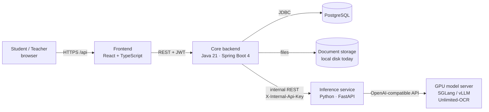
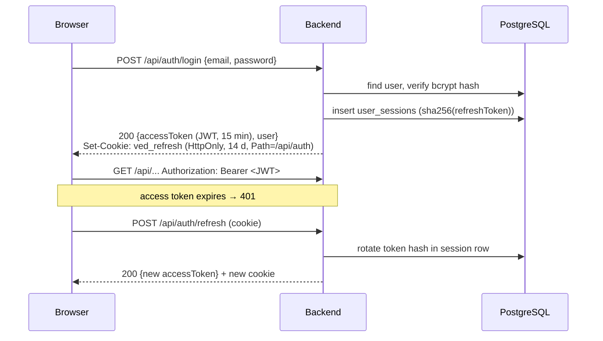
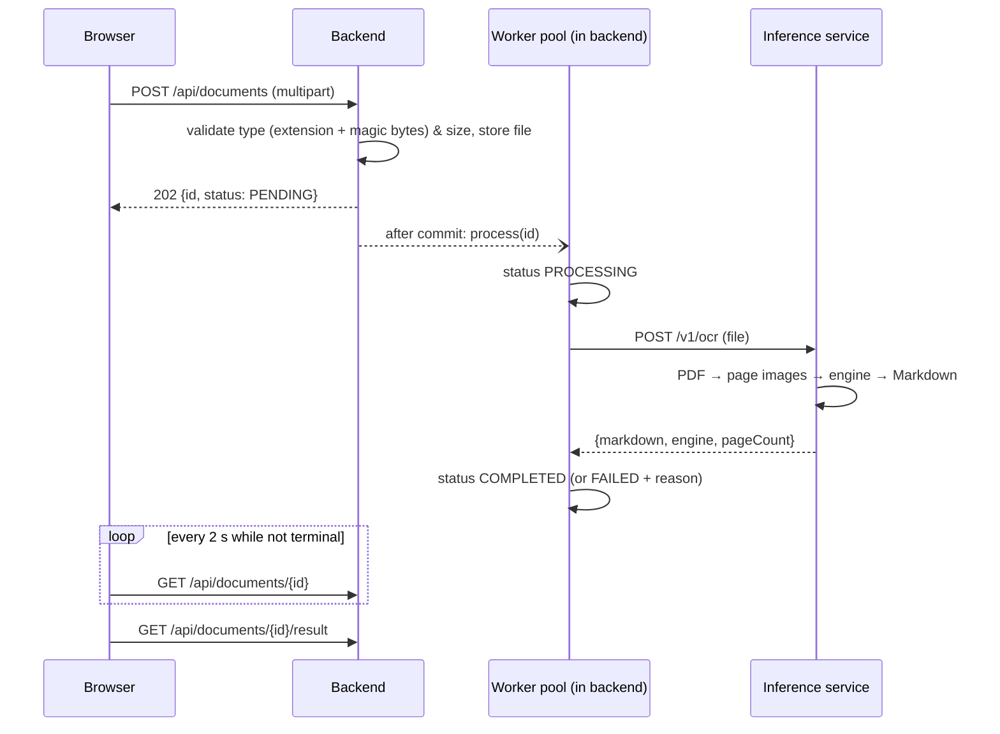
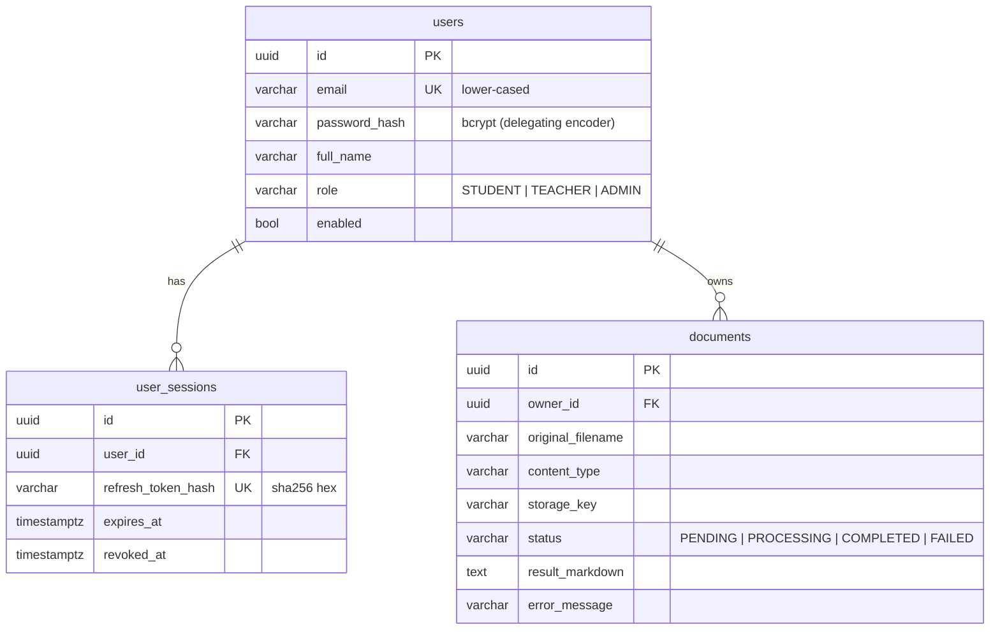

# Architecture overview

## System context



| Component | Folder | Responsibility | Talks to |
|---|---|---|---|
| Frontend | `frontend/` | UI only. No business rules beyond input hints. | Backend (`/api`) |
| Core backend | `backend/` | **The single source of truth**: identity, authorisation, domain data, job orchestration. | PostgreSQL, storage, inference |
| Inference service | `inference/` | Stateless AI/ML computations (OCR today; grading, recommendations, analytics later). No database, no user concept. | Model servers / local models |

Ground rules:

1. **Only the backend is public.** The inference service is internal and trusts the backend
   (shared API key). Browsers never call it.
2. **Only the backend owns data.** The inference service receives inputs and returns outputs; it
   never stores user data.
3. **Language per job:** Java for business logic, Python for ML, TypeScript for the UI
   ([ADR-0001](../adr/0001-polyglot-three-service-architecture.md)).

## Backend internals

Package-by-feature (`com.ved.<feature>`), with a thin layered structure inside each feature:

```
com.ved
├── common/        cross-cutting: error model, time, pagination
├── security/      JWT issuing/validation, CORS, @CurrentUserId
├── user/          User aggregate, /api/users
├── auth/          register/login/refresh/logout use-cases
│   └── session/   refresh-token sessions (open / rotate / revoke)
└── document/      upload + OCR conversion
    ├── storage/   DocumentStorage port + local filesystem adapter
    ├── ocr/       OcrGateway port + inference-service HTTP adapter
    └── processing/ async worker, triggers (after-commit, startup recovery)
```

Inside a feature: `Controller → Service → Repository / Port`. Controllers handle HTTP only;
services hold the use-cases and transactions; **ports** (interfaces) wrap anything external
(storage, OCR, token format) so it can be swapped without touching the use-cases. See
[conventions.md](conventions.md).

## Key flows

### Authentication



Details: [specs/auth.md](../specs/auth.md), [ADR-0002](../adr/0002-jwt-access-tokens-with-rotating-refresh-sessions.md).

### Document conversion (OCR)



Details: [specs/ocr.md](../specs/ocr.md), [ADR-0003](../adr/0003-pluggable-ocr-engines-in-a-python-service.md),
[ADR-0004](../adr/0004-in-process-async-document-processing.md).

## Data model (M1)



Schema changes are **Flyway migrations** in `backend/src/main/resources/db/migration`
(`V<n>__<description>.sql`). Never edit a migration that has run in a shared environment; add a new one.
Hibernate only *validates* the schema (`ddl-auto: validate`).

## Frontend internals

```
src/
├── app/            routing + authenticated layout
├── shared/         feature-agnostic code
│   ├── api/        fetch wrapper (token, single-flight refresh), ApiError
│   ├── lib/        formatting, downloads
│   └── ui/         small presentational components
└── features/
    ├── auth/       AuthProvider (session state), pages, route guards
    └── documents/  API client, upload, list, detail
```

A feature owns its API calls, types and pages. `shared/` must not import from `features/`.
The access token lives in memory only; on reload the session is restored with the HttpOnly
refresh cookie.

## Inference service internals

```
ved_inference/
├── api/          FastAPI routes, schemas (camelCase JSON), API-key check
├── service.py    OcrService use-case (load → engine → result), concurrency limit
├── documents/    loader: PDF/image bytes → page images (PyMuPDF, Pillow)
└── engines/      OcrEngine ABC + implementations + registry
```

Engines are chosen by `VED_INFERENCE_ENGINE`; see [guides/ocr-engines.md](../guides/ocr-engines.md).
