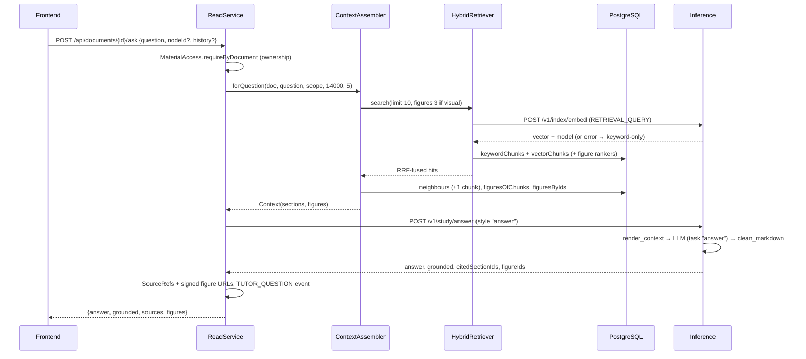

# Retrieval and context assembly

How the knowledge store is queried and how the result is turned into compact, citable context for the LLM.

Code: `backend/.../knowledge/retrieval` (`HybridRetriever`, `ContextAssembler`), `backend/.../knowledge/store/KnowledgeStore.java`,
`backend/.../knowledge/web`, `backend/.../study/read`, `backend/.../study/learn/LessonService.java`,
`inference/.../study/{prompts,service}.py`

Related: [knowledge-storage.md](knowledge-storage.md) (tables and indexes), [document-parsing.md](document-parsing.md)
(how the tree is built), [backend-inference-integration.md](backend-inference-integration.md),
[spec: knowledge](../specs/knowledge.md), [ADR-0009](../adr/0009-knowledge-store-tree-hybrid-index-figures.md),
[configuration guide](../guides/configuration.md).

## The two layers

| Layer | Class | Job |
|---|---|---|
| Search | `HybridRetriever` | Query → ranked chunk ids and figure ids (keyword + vector, fused with RRF). Knows nothing about LLMs. |
| Context | `ContextAssembler` | Hits or tree nodes → `Context(sections, figures)` within a character budget: small-to-big expansion, breadcrumbs, summaries, figures. |

Callers pick the context mode that fits the use:

| Mode | Used by | Input |
|---|---|---|
| `forQuestion` | "Ask your document" (`ReadService.ask`), Learn tutor (`LessonService.ask`) | free-text question, optional subtree scope |
| `forNodes` | lessons, questions, grading (via `MaterialAccess.sources`), section notes | a topic's / question's node ids |
| `childSummaries` | chapter overview notes (map-reduce "reduce") | one node; its children's summaries and notes |
| `HybridRetriever.search` directly | `GET /api/documents/{id}/search` (`KnowledgeService.search`) | search box text, optional `nodeId` |

## Hybrid search

```
query ─┬─ embed(query, RETRIEVAL_QUERY) ──► vectorChunks  (top 30, cosine, same model only) ─┐
       └────────────────────────────────► keywordChunks (top 30, ts_rank_cd)               ─┴─ RRF(keyword 1, vector 2, k=10) → top N chunks
       (figures, only when asked for)     keywordFigures + vectorFigures (sim ≥ 0.48)       ─── RRF(keyword 1, vector 2, k=10) → top M figures
```

### 1. Query embedding

`HybridRetriever.embedQuery` calls `KnowledgeAi.embed(RETRIEVAL_QUERY, [text])` (inference `POST /v1/index/embed`).
Documents are embedded with `RETRIEVAL_DOCUMENT` at indexing time; the asymmetric task types are passed through to
the embedding provider (`taskType` for Gemini). The response carries the model identity (`provider:model`, e.g.
`gemini:gemini-embedding-2`), which scopes the vector search.

### 2. Keyword search (inverted index)

`KnowledgeStore.keywordChunks`:

- `websearch_to_tsquery(search_config, query)`: users can type `"quoted phrases"`, `-exclusions`, `OR`. The text-search
  configuration (`regconfig`) is the one stored on the document's chunks, so stemming matches the document language.
- Match on the generated `tsv` column (GIN index), rank with `ts_rank_cd` (cover density: rewards query terms that
  occur close together).
- `ts_headline(..., 'MaxFragments=1, MaxWords=32, MinWords=14, StartSel=**, StopSel=**')` produces the highlighted
  search snippet (`**term**`).

Figures have their own `tsv` over `caption || ' ' || description` (`keywordFigures`, no snippet).

### 3. Vector search (dense index)

`KnowledgeStore.vectorChunks`: `ORDER BY embedding <=> :query` (pgvector cosine distance, HNSW `vector_cosine_ops`
index), score `1 - distance`, snippet = first 240 characters. Rows are filtered to
`embedding IS NOT NULL AND embedding_model = :queryModel`: vectors from different models live in different spaces
and are never compared.

### 4. Subtree scoping

Both chunk rankers accept `scopePaths` (ltree paths). The filter is `n.path <@ ?::ltree[]` (descendant-or-self of any
path in the array, GiST index on `document_nodes.path`); `null` means the whole document. Scope sources:
`nodeId` on search and ask, the topic's node ids for the tutor. Figure search is not subtree-scoped.

### 5. Weighted Reciprocal Rank Fusion

`HybridRetriever.fuse` merges the ranked lists:

```
score(d) = Σ over lists containing d of  w_list / (k + rank_d)     rank_d is 1-based, k = rrf-k = 10,
                                                                   w = keyword-weight 1.0 / vector-weight 2.0
```

RRF uses ranks only, so the incomparable scales of `ts_rank_cd` and cosine similarity do not matter, and a chunk
found by both rankers rises to the top. The weights say how much each ranker is trusted.

The values were tuned with `inference/scripts/eval_embeddings.py --tune` (grid over weights and k, see
[configuration.md](../guides/configuration.md#choosing-an-embedding-model-measure-on-your-own-documents)) on 268
questions over 3 documents, half in a student's natural wording, half deliberately reworded. Against plain RRF
(1 : 1, k=60) the right passage ranked #1 for 85% instead of 80% (natural) and 79% instead of 76% (reworded), top-3
unchanged at ~99% / ~93%, mean MRR 0.871 → 0.895; figures #1 rose from 82% to 91% (natural) and 73% to 82%
(reworded). Measured with the in-house Qwen vectors (Gemini's daily quota ran out during tuning); to be re-checked
on `gemini-embedding-2`. Trade-off: a chunk found only by keyword search, even at #1 (1/11 ≈ 0.091), now ranks
below anything meaning search alone puts in its top 11 (2/21 ≈ 0.095). Safeguard in `HybridRetriever.fuse`: each
ranker's #1 always survives the cut to `limit` (it replaces the last unprotected slot), so an exact-term match that
meaning search misses is never dropped. Each ranker contributes `candidates` (30) items. When a chunk appears in both
lists, the keyword hit's snippet is preferred if it contains a `**` highlight.

### 6. Figure search

Run only when `figureLimit > 0`: the search endpoint always asks for 4; `forQuestion` asks for 3 only when the
question looks visual (regex on `diagram|figure|image|picture|chart|graph|illustrat*|draw*|show me|look like|map|table`),
otherwise 0. Keyword figure hits always count; vector figure hits must reach `figure-min-similarity` (0.48).

Calibration of 0.48 on `gemini-embedding-2` against a real document: on-topic figures scored about 0.52-0.56,
loosely related 0.42-0.46, unrelated 0.36-0.38. The threshold is model-specific: re-tune it when switching
embedding models.

### Graceful degradation

| Situation | Behaviour |
|---|---|
| Embedding call fails (`KnowledgeAiException`: provider down, out of quota) | Logged as a warning; search continues **keyword-only** (dense list empty). |
| Embedding model switched in inference settings | Only vectors of the query's model are searched (others ignored) and keyword search still works. `hasStaleEmbeddings` detects vectors of another model and publishes `StaleEmbeddingsDetected`; `KnowledgeIndexer.onStaleEmbeddings` (async, document worker pool, one run per document) clears and re-embeds them. If that fails it resumes on the next search. |
| Nothing found | Ask falls back to an outline: level-1 nodes via `forNodes` (2,000 chars, no figures). Tutor falls back to the topic's own sections within the tutor budget. |

## Context assembly

### Small-to-big (`forQuestion`)

1. `HybridRetriever.search(..., limit = 10, figureLimit = 0 or 3)`.
2. For each hit, in fused order, `KnowledgeStore.neighbours(nodeId, ordinal, radius = 1)`: the hit chunk plus the
   previous and next chunk of the **same node**. Chunks are added (deduplicated) until the budget's characters are
   used; the check runs before each chunk, so the last one may overshoot slightly.
3. Chunks are grouped per node, and nodes become **sections** sorted by document order, each carrying the node's
   summary (from indexing) and breadcrumb, so the model sees the "big" context around a small passage.
4. Figures: those anchored to any selected chunk (`figuresOfChunks`) first, then figure search hits; only figures
   with a description (indexed and `VISUAL`) survive, capped at the budget's `figures`.

### Node-driven (`forNodes`)

For each node id: all chunks of its subtree in order (`chunksInSubtree`, `path <@`) until the budget is reached
(the first chunk always fits), plus every figure in the subtree. A node with no own text (e.g. a chapter heading)
still yields a section with its summary.

### Budgets (`ved.study.context.*`)

Characters of source text and maximum figures per use (`StudyProperties.Budget`, `application.yml`):

| Use | chars | figures | Mode |
|---|---|---|---|
| `lesson` | 24000 | 6 | `forNodes` (topic nodes) |
| `questions` | 12000 | 0 | `forNodes` per topic |
| `grade` | 6000 | 0 | `forNodes` (question's source nodes, else topic nodes) |
| `tutor` | 10000 | 2 | `forQuestion` scoped to the topic |
| `ask` | 14000 | 5 | `forQuestion`, optional `nodeId` scope |
| `notes` | 18000 | 5 | `forNodes` (one node); also the "large node" threshold |

## Context format sent to the LLM

The backend sends structured records (`StudyAi.Section`, `StudyAi.Figure`); the inference service renders them
with `prompts.render_context` into a YAML-like block appended to the prompt:

```yaml
SECTIONS:
- id: "§2.3"
  path: "Chapter 2 Cells › 2.3 Osmosis"
  pages: "14-15"
  summary: Water moves across a semi-permeable membrane towards the higher solute concentration…
  passages:
    - Osmosis is the diffusion of water molecules…
    - In plant cells, the cell wall resists…
FIGURES:
- id: "7f3a0c2e-…"
  section: "§2.3"
  caption: Figure 2.4: Osmosis in a plant cell
  description: Diagram showing water moving into a vacuole…
```

- Section `id` is `"§" + node.path` (the ordinal ltree path, `ContextAssembler.citationId`), not the book's label;
  the label appears in `path` (breadcrumb uses `label title`, or just `title` when the node has no own numbering).
- Figure `id` is the figure's UUID. Pixels are never sent at generation time; the vision-model description stands in.

`CONTEXT_RULES` in the prompt tells the model to cite `[§id]` after the statements they support and to embed a
helpful figure on its own line as ``, never inventing ids and using each figure once.

### Output validation (inference)

`study/service.py` treats output as untrusted:

- `clean_markdown` normalises every markdown image: strips a `figure:` / `figure://` prefix, keeps the image only if
  its id was in the request's figures and not used before, and rewrites it as ``; external
  URLs and unknown ids are removed. Citations `[§x]` to sections not in the request are removed.
- `cited_ids` returns the section ids actually cited; `figure_ids` the figures actually embedded.

### Back in the backend

`ReadService` maps `citedSectionIds` to node ids → `SourceRef(citation, nodeId, label, title, pages)`, and
`FigureViews.byIds(figureIds)` returns a `figures` map (`id → {url, caption, description, …}`) with **HMAC-signed,
expiring URLs** (`FigureUrlSigner`, `/api/figures/{id}/image?exp=&sig=`, TTL `ved.knowledge.figure-url-ttl`, expiry
aligned to the hour so URLs are cacheable). The markdown keeps `figure:<id>`; the shared frontend `Markdown` renderer resolves it from the `figures` map as an
inline figure (caption, click to enlarge; unknown ids are dropped) and shows `[§x]` citations as small source chips
(`shared/ui/markdown/citations.ts`: each section once per paragraph, at its last mention).

## "Ask your document"



The tutor (`POST /api/topics/{topicId}/ask`) follows the same path with the topic's nodes as scope, the `tutor`
budget and style `"tutor"` (short, conversational).

## Study notes (map-reduce over the tree)

`ReadService.notes` generates once per node and style (`EXPAND` in depth, `REVISION` condensed; see
[knowledge.md](../specs/knowledge.md#public-api-backend-authenticated)) and caches in `study_notes`:

- **Section notes** (scope `section`): `forNodes(node, notes budget)`.
- **Overview notes** (scope `overview`) when the node has children **and** its subtree text exceeds the notes
  budget (18,000 chars). The "map" was done at indexing (bottom-up node summaries). The "reduce" context is: the
  node's own text (up to 3,000 chars, if any) + one section per child (`childSummaries`) with the child's summary and,
  if already generated, the child's notes of the same style truncated to 2,500 chars; up to 4 figures from the subtree. The reader
  opens each subsection's own notes from there.

Concurrent generation of the same node and style is resolved by the unique `(node_id, style)` (the loser re-reads
the saved note).

## Tunings

| Key | Default | Effect |
|---|---|---|
| `ved.knowledge.retrieval.candidates` | 30 | Items per ranker before fusion. Higher = better recall, more rows scanned. |
| `ved.knowledge.retrieval.rrf-k` | 10 | RRF constant; higher flattens the advantage of top ranks. |
| `ved.knowledge.retrieval.keyword-weight` / `vector-weight` | 1.0 / 2.0 | How much each ranker counts in the fusion. Tuned on our documents (section 5). |
| `ved.knowledge.retrieval.figure-min-similarity` | 0.48 | Cosine floor for semantic figure matches; model-specific. |
| `ved.knowledge.figure-url-ttl` | 6h | Signed figure URL validity (on top of hour alignment). |
| `ved.study.context.<use>.chars` / `.figures` | see Budgets | Grounding vs latency/cost per use. |

Hard-coded today: 10 chunks per question, neighbour radius 1, 3 figures for visual questions, 4 figures on search,
search `limit` clamped to 1-30 (default 12), outline fallback 2,000 chars, overview own-text 3,000 / child-notes
2,500 chars / 4 figures.

## Known limitations and future work

- **No re-ranking**: RRF order is final. A cross-encoder or LLM re-ranker over the top ~30 is deferred (ADR-0009).
- **No query rewriting**: follow-ups like "why does that happen?" are searched literally; history is sent to the
  LLM but not used for retrieval. Rewriting the question with the history (or HyDE) would help.
- **Visual intent is a keyword regex** (English only).
- **Filtered HNSW**: the vector query filters by document and model; with pgvector's default `ef_search` a heavily
  filtered HNSW scan can return fewer than `candidates` rows. Fine at current scale; revisit (iterative scans,
  partial indexes) as the corpus grows.
- **Figure search ignores subtree scope**, so a scoped question can surface a figure from another chapter.
- Small-to-big expands within a node only (no cross-node neighbours); per-hit `chunksByIds` lookups are N+1 queries.
