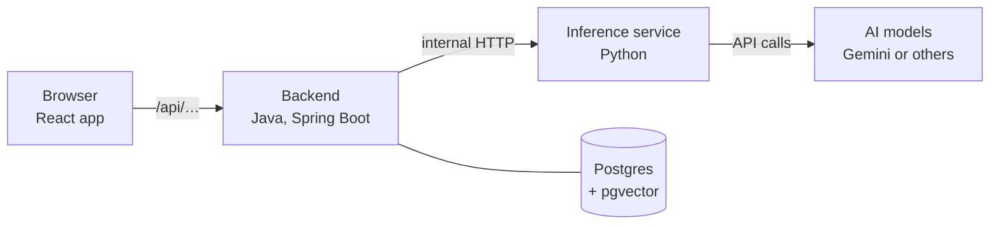
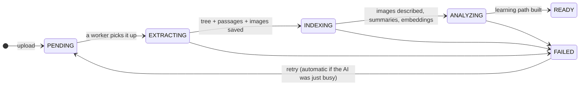

# How Ved works: a plain-language guide

This guide explains how Ved turns a student's PDF into lessons, tests and answers. It assumes no background
in AI or search. Every idea is introduced from scratch, with examples from a real upload (a 30-slide DevOps
deck about Kubernetes).

The architecture documents in [`docs/architecture/`](../architecture/) cover the same ground in engineering
detail. Read this guide first; use those when you need exact names, numbers and edge cases.

**Contents**

1. [The big picture](#1-the-big-picture)
2. [The journey of a document](#2-the-journey-of-a-document)
3. [Embeddings, explained from zero](#3-embeddings-explained-from-zero)
4. [How search works](#4-how-search-works)
5. [From search results to what the AI reads](#5-from-search-results-to-what-the-ai-reads)
6. [How study content is made](#6-how-study-content-is-made)
7. [Guardrails](#7-guardrails)
8. [Swapping AI models](#8-swapping-ai-models)
9. [Glossary](#9-glossary)
10. [Where things live in the code](#10-where-things-live-in-the-code)

---

## 1. The big picture

Ved is three programs that talk to each other:



| Part | Think of it as… | What it does |
|---|---|---|
| **Frontend** (React) | The classroom | Everything the student sees and clicks. |
| **Backend** (Java) | The school office | Accounts, who owns what, the database, the step-by-step workflow, progress and XP. It decides *what* to do. |
| **Inference service** (Python) | The specialist | Reads PDFs, runs OCR, and talks to AI models. It knows *how* to do the hard parts. |
| **Postgres** | The filing cabinet | Stores users, documents, the document tree, search indexes, lessons, progress. |

The browser never talks to the inference service or to the AI directly. Everything goes through the backend,
which checks that the student owns what they're asking for.

**One rule shapes everything:** the AI never gets the whole document. Ved first organises the document so it
can hand the AI *only the few relevant pieces*, labelled so the AI can cite them. That makes answers more
accurate, cheaper and checkable.

---

## 2. The journey of a document



These are the statuses you see on the library card (Dia's "workbench").

### 2.1 Upload

The student drops a PDF or image. The backend checks it (allowed type, at most 25 MB), saves the file to disk,
and records a `documents` row with status **PENDING** and the student as **owner**. A small pool of background
workers processes documents one after another, so uploading many files never overloads the AI.

### 2.2 Reading the pages (EXTRACTING)

**Problem:** a PDF is not text. It is instructions for drawing letters and pictures at positions on a page.
Some PDFs contain real text (a "text layer"); scanned ones are just photos of pages.

**What Ved does, page by page:**

- If the page has a usable text layer (at least 50 letters/digits), read it directly. Fast and exact.
- Otherwise run **OCR** (optical character recognition: software that reads text from an image).

A **layout model** then looks at each page and labels every block on it: *heading*, *paragraph*, *table*,
*formula*, *picture*, *caption*, *page header/footer*. Headers and footers (repeated on every page) are thrown
away.

> In the DevOps deck, slide 11 is a full-slide screenshot of a terminal. It has no text layer, so OCR reads
> the terminal's text ("minikube start", "kubectl get nodes", …) and that text becomes part of the slide's
> content.

### 2.3 Building the tree

A textbook has a table of contents: chapters contain sections, which contain subsections. Ved rebuilds that
structure from the headings and their numbering, and gives every part an **index** like `2.3.1`.

```
DevOps Session 4                        (document)
├── 1    Introduction to Containers
│   ├── 1.1  What is Container Orchestration?
│   │   └── 1.1.1  Why microservices need it
│   └── 1.2  …
├── …
└── 5    Kubernetes Architecture Sample
```

Each part of the tree is a **node**, and it remembers its title, its index (`path`) and its page range.

**Why a tree?** Because it lets Ved say "give me everything in section 2.3", "which chapter is this in?", or
"summarise chapter 2 from its sections". Flat text can't answer those. When a document has no headings at
all, Ved falls back to one node per five pages.

### 2.4 Passages ("chunks")

Each node's text is cut into small passages of about 900 characters (roughly a paragraph or two). A passage
never splits a table or formula, and a figure's caption stays with its figure.

**Why small?** Think of index cards. If a student asks about *etcd*, you want to pull out the one card about
etcd, not a 20-page chapter. Small cards make search precise; the tree (each card knows its node) lets Ved
pull in the surrounding context when it's needed (see [section 5](#5-from-search-results-to-what-the-ai-reads)).

### 2.5 Images

Images and vector drawings (diagrams drawn with lines, not pixels) are cut out of the pages and saved as
files. Then they go through two filters.

**Filter 1: simple rules** (no AI), to throw away obvious junk:

| Rule | Catches |
|---|---|
| Too small (under 100 px or 1.2 % of the page) | Icons, bullets |
| Extremely wide or tall (more than 6:1) | Banners, divider lines |
| The same **small** image on 3+ pages | Logos, slide-template decorations |
| Covers almost the whole page behind text | Page backgrounds |

A **large** image that repeats is *content* the author reused. In the DevOps deck, the Kubernetes
architecture diagram appears on slides 7 and 13 to 18. Ved keeps it once per section, so every section that
discusses it can show it.

**Filter 2: the AI looks at each image.** A vision model (an AI that can see images) writes a description,
for example *"Architecture diagram: the control plane (API server, scheduler, controller manager, etcd)
manages worker nodes running pods…"*, and gives the image a **role**:

| Role | Example | What happens |
|---|---|---|
| **VISUAL** | Diagrams, charts, photos | Kept and shown to students. |
| **TEXTUAL** | Terminal output, code screenshots | The image is dropped; a labelled transcript ("*Screenshot:* … plus the key lines") is added to the section text, so it stays searchable. |
| **DECORATIVE** | Logos, clip-art | Dropped. |

The description matters beyond accessibility: it is what makes a picture *searchable by words*, and it lets
the AI know what a figure shows without paying to look at the image again.

### 2.6 Summaries and key terms (INDEXING)

The AI summarises every node, **bottom-up**: subsections first, then each section from its own text plus its
subsections' summaries, then chapters. A chapter summary is therefore built from summaries, never from 40
pages of raw text. Each node also gets 3-8 **key terms** ("kubelet", "etcd", "control plane"), which form a
back-of-the-book term index (term → sections).

Then come the **embeddings** (next section), and finally the **learning path** (ANALYZING, see
[section 6.1](#61-the-learning-path)).

### 2.7 When the AI is busy

Free AI plans limit how many requests you can make per minute or day. When Ved hits that limit, it doesn't
fail: the document is **paused** (sleepy Dia on the card) and resumes automatically after 1, then 4, then 15
minutes. Every step saves its progress in small batches, so a resumed document continues where it stopped
instead of starting over.

---

## 3. Embeddings, explained from zero

### 3.1 The idea: meaning as a location

Imagine placing every sentence on a map so that sentences **with similar meaning end up close together**:

```
            "how do cells get energy?"  •
                 "ATP is produced in the mitochondria" •
                                                              • "the French Revolution began in 1789"
  "pods are scheduled onto worker nodes" •
         • "the scheduler assigns pods to nodes"
```

"The scheduler assigns pods to nodes" and "pods are scheduled onto worker nodes" share few exact words but
sit next to each other, because they *mean* nearly the same thing.

An **embedding** is a sentence's location on that map, written as a list of numbers (coordinates). A real map
has 2 coordinates; Ved's embedding model uses **768**, because meaning has many more "directions" than
north-south and east-west (topic, tone, technical level, and so on). Nobody hand-picks these directions: the
model learned them from enormous amounts of text.

```
"the scheduler assigns pods to nodes"  →  [0.021, -0.113, 0.087, …, 0.004]   (768 numbers)
```

### 3.2 Measuring "close": cosine similarity

Two embeddings are compared by the **angle** between them, not the raw distance. This is called **cosine
similarity**: 1 means the same direction (same meaning), around 0 means unrelated.

A toy example with 3 numbers instead of 768:

| Text | Embedding |
|---|---|
| A: "control plane manages the cluster" | [0.9, 0.1, 0.0] |
| B: "the master node oversees the cluster" | [0.8, 0.2, 0.1] |
| C: "photosynthesis in leaves" | [0.0, 0.1, 0.9] |

A and B point almost the same way (cosine ≈ 0.98: very similar). A and C are nearly perpendicular (cosine
≈ 0.01: unrelated). Real numbers are less extreme: in Ved's documents, a question and the passage that answers
it typically score around 0.5-0.6, and unrelated text around 0.35.

### 3.3 What exactly Ved embeds

The embedding model is `gemini-embedding-2` (configurable, see [section 8](#8-swapping-ai-models)). It is
called from the inference service; the backend stores the numbers.

| What | Text sent to the model | Why |
|---|---|---|
| **Each passage** | Its breadcrumb + its text, e.g. `"Kubernetes Architecture › Master Node\nThe API server is the front end…"` | The breadcrumb adds context the passage itself may lack ("it" → which component?). |
| **Each kept figure** | The **image itself** + its caption + its AI description | The model is *multimodal*: pictures and words share one map, so the question "show me the cluster architecture" can land next to the diagram. |
| **Each question** (at search time) | The student's question | So it can be compared with the stored passages and figures. |

Two small but important details:

- **Two "task" modes.** Passages are embedded as *documents* and questions as *queries*. The model positions
  them slightly differently so that a short question lands near the longer passage that answers it.
- **The model's name is saved with every vector.** Embeddings from different models live on different maps
  and must never be compared. If you switch models, Ved only compares vectors from the same model, and
  re-embeds old documents in the background the first time they're searched.

### 3.4 Where embeddings are stored

In Postgres, in a `vector(768)` column next to each passage and figure (the **pgvector** extension adds that
column type). To avoid comparing a question against every passage one by one, there's an **HNSW index**: a
pre-built network of "shortcuts" between nearby vectors. Think of it like asking for directions: hop to a
roughly right neighbourhood, then to a closer street, then to the house. It finds the nearest neighbours in
milliseconds, at the cost of being *approximately* rather than perfectly exact.

---

## 4. How search works

Search runs whenever the student asks the tutor something, or uses "ask your document" / document search.
Ved runs **two different searches** and merges them.

### 4.1 Keyword search (the book's index)

At the back of a textbook, "etcd ... 14, 22" tells you exactly where a word appears. Postgres keeps the same
thing for every passage: an **inverted index** (word → passages containing it).

- Words are reduced to their stem ("scheduling", "scheduled", "schedules" → "schedul") and filler words
  ("the", "of") are ignored, using the document's language.
- Searches understand quotes and minus signs, like a web search: `"control plane" -minikube`.
- Results are ranked by how often and how closely together the search words appear.
- Ved also cuts out a **snippet** with the matching words in **bold**, which is what you see in search results.

**Good at:** exact terms, acronyms, names, formulas (`etcd`, `kube-proxy`, `ATP`, `E=mc²`).
**Bad at:** the same idea in different words. "Which part decides where containers run?" contains neither
"scheduler" nor "pod".

### 4.2 Vector search (meaning)

The question is embedded (section 3) and Postgres finds the passages whose embeddings are nearest by cosine
similarity, using the HNSW index.

**Good at:** meaning and paraphrase. The question above lands next to the passage about the scheduler.
**Bad at:** rare exact tokens, like a specific error code or command flag the model has no feel for.

### 4.3 Merging them: Reciprocal Rank Fusion

Each search returns its top **30** candidates, but their scores are on different scales (a keyword rank of 0.3
and a cosine of 0.6 can't be added). So Ved ignores the scores and uses only the **positions** in each list:

```
score(passage) = Σ over both lists of  1 / (60 + position)
```

Worked example (positions start at 1):

| Passage | Keyword position | Vector position | Score |
|---|---|---|---|
| "The scheduler assigns pods…" | 2 | 1 | 1/62 + 1/61 = **0.0325** |
| "kube-scheduler config flags…" | 1 | not found | 1/61 = 0.0164 |
| "Pods are the smallest unit…" | not found | 2 | 1/62 = 0.0161 |

A passage that **both** searches like wins clearly. The constant 60 is the standard value from the research
paper that introduced the method; it stops the #1 spot from dominating everything else.

### 4.4 Searching only part of a document

Every node's index is stored as a path (`2.3.1`), and Postgres can ask "is this inside `2.3`?" very
efficiently (the **ltree** extension). The tutor in a lesson only searches the sections of the topic you're
studying, so it doesn't drag in later material.

### 4.5 Searching for figures

Figures are searched the same two ways: keywords in their captions and descriptions, and vector similarity of
their image-plus-text embedding. Vector matches for figures must clear a **similarity threshold of 0.48**.
That number was measured on a real document:

| Query vs. figure | Typical cosine similarity |
|---|---|
| On-topic ("what is osmosis?" vs. the osmosis diagram) | 0.52-0.56 |
| Loosely related | 0.42-0.46 |
| Unrelated | 0.36-0.38 |

Without the threshold, a small document would return *every* figure for *every* question. The threshold is
specific to the embedding model, so it must be re-measured if the model changes.

### 4.6 When something is down

- **Embedding service unavailable?** Search continues with keywords only.
- **Model just switched?** Only vectors from the current model are compared, plus keywords, while old ones are
  re-embedded in the background.

---

## 5. From search results to what the AI reads

### 5.1 Small-to-big

Search finds small passages (precise), but a passage alone can lack context. So for each hit Ved also takes
its **neighbouring passages** (one before, one after, within the same section) and the section's **summary**.
Small to find, bigger to understand.

### 5.2 Budgets

Every use has a budget: the maximum characters of source text (and figures) sent to the AI. Bigger budgets
mean better grounding but slower and costlier calls.

| Use | Source text | Max figures |
|---|---|---|
| Lesson | 24,000 chars | 6 |
| Notes | 18,000 | 5 |
| Ask your document | 14,000 | 5 |
| Test questions | 12,000 | 0 |
| Tutor | 10,000 | 2 |
| Grading a written answer | 6,000 | 0 |

These live in `backend/src/main/resources/application.yml` under `ved.study.context`.

### 5.3 Structured context with ids

The AI doesn't receive a wall of text. It receives a labelled list:

```yaml
SECTIONS:
- id: "§5.1"
  path: "Kubernetes Architecture › Master Node"
  pages: "13"
  summary: The master node is the control centre of the cluster…
  passages:
    - The API Server is the primary interface for managing the cluster…
FIGURES:
- id: "7f3a2c…"
  section: "§5.1"
  description: Architecture diagram: control plane (API server, scheduler, etcd) managing two worker nodes…
```

The ids are the point: the AI is told to **cite** every claim as `[§5.1]` and to embed a figure only as
`` using an id from the list. That's what makes answers checkable and images
possible. In the app, `[§5.1]` becomes a small source chip, and the figure placeholder becomes the real image.

---

## 6. How study content is made

### 6.1 The learning path

Once a document is indexed, the AI receives its **outline**: every node's index, title, pages, summary and key
terms, plus a 1,500-character sample of the text, but never the full text. It designs up to 12 **topics**,
each a coherent 5-10 minute lesson, in learning order (illustrative):

```
Topic 1  Introduction to Container Orchestration    INTRO   → nodes 1, 1.1, 1.1.1
Topic 2  Kubernetes Core Concepts & Overview        INTRO   → nodes 2, 2.1
…
Topic 6  Inside the Master Node                     CORE    → nodes 5.1-5.6
```

Each topic points to the tree nodes it covers. Front matter (contents, references) is skipped.

### 6.2 Lessons

A lesson is written **the first time the student opens that topic**, then saved, so reopening it is instant.
It belongs to that student's document and nobody else can see it.

How it's written:

1. The backend gathers the topic's sections in document order, within the lesson budget (24,000 chars, up to
   6 figures from those sections).
2. The AI is given the topic title, its key concepts, its difficulty, what came **before** (so it can link
   back) and what comes **after** (so it doesn't teach that yet).
3. The lesson has a fixed, research-backed shape:

| Part | What it is | Why (learning science) |
|---|---|---|
| **Warm-up question** | One question *before* any teaching, answerable by reasoning or a guess. | *Pretesting effect*: attempting an answer first, even wrongly, improves later learning. |
| **3-6 sections** | `CONCEPT`, `EXAMPLE`, `ANALOGY`, ending with a `SUMMARY`. 80-250 words each. | *Cognitive load*: one idea at a time. Examples and analogies make abstract ideas concrete. |
| **2-3 checks** | Questions placed right after the section they test. | *Retrieval practice*: recalling beats re-reading. |
| **Key takeaways** | A short list at the end. | Consolidation. |

4. Every fact is cited (`[§1.1.1]`), and figures are embedded by id.
5. **Clean-up before saving:** any figure id the AI made up (not in the list it was given) is removed, so the
   AI can never show an image that doesn't exist or isn't from this document.

**How the image reaches the screen:** the lesson is sent with a `figures` map (id → caption, description,
size, link). The link is **signed**: `/api/figures/<id>/image?exp=…&sig=…`. The signature proves the backend
issued it, and `exp` makes it expire (within about 7 hours). This lets a plain `` tag load it. The
frontend replaces each `figure:<id>` placeholder with the image, a caption, and click-to-enlarge.

### 6.3 The tutor

During a lesson the student can ask the tutor anything. Ved runs the hybrid search **only within that topic's
sections**, assembles a small context (10,000 chars, up to 2 figures) and the AI answers conversationally,
citing sections. If nothing relevant is found, it falls back to the topic's own sections.

### 6.4 Tests

1. **Questions** are generated per test (3-20, chosen by the student), from each chosen topic's sections, and
   avoid questions the student has already seen.
2. They are **interleaved** (topics mixed rather than grouped): mixing helps students tell similar ideas
   apart.
3. **Grading:** multiple-choice and true/false are graded instantly by the backend. Written answers are graded
   by the AI against a reference answer **and** the question's source sections, with a verdict (correct /
   partial / incorrect), a score and specific feedback.
4. A **report** summarises strengths, weak areas and next steps.

Students also rate their **confidence** before seeing the result: confident mistakes, once corrected, are
remembered especially well (the *hypercorrection effect*).

### 6.5 Spaced review (Leitner boxes)

Every answered question becomes a review card in one of 5 boxes:

| Box | Next review after |
|---|---|
| 1 | 1 day |
| 2 | 3 days |
| 3 | 7 days |
| 4 | 16 days |
| 5 | 35 days |

Correct → up one box (longer wait). Partial → same box. Wrong → back to box 1, and due again in **10 minutes**
(re-test soon after an error). Reviewing just as you're about to forget is what makes memories last
(*spacing effect*).

### 6.6 Mastery

A topic's mastery is a **weighted average of the last 10 scores**, where newer scores count more (weights 1,
0.85, 0.85², …).

Example, newest first: 1.0, 1.0, 0.0 → (1×1.0 + 0.85×1.0 + 0.72×0.0) / (1 + 0.85 + 0.72) ≈ **0.72**.
Recent success outweighs an older slip. At **0.8** a topic counts as mastered.

### 6.7 Notes and "ask your document"

The document's **Preview** tab (on the study hub) has three views: **Reading view** shows the document as Ved
understood it (sections in order, figures in place, a contents list), **Original** shows the file exactly as you
uploaded it (the browser's own PDF/image viewer), and **Raw text** shows the extracted Markdown.

- **Notes**: in the Reading view, a section with subsections or a fair amount of text (250+ characters) can be
  switched from *Original* to **Expand** (an in-depth explanation: small steps, why and how, jargon in plain words,
  examples and analogies) or **Revision** (only the key points, ending with a short "Quick self-test"). This
  works once the course is ready. Each style is generated from that section's full text and figures, then saved,
  so the second visit is instant. For a big chapter, Ved writes notes for its subsections first and combines
  them (map-reduce: summarise the parts, then the whole).
- **Ask your document** works in the backend API but has no screen yet (planned with the rest of "Read mode":
  tree navigation and search). It runs hybrid search across the whole document (or a chosen chapter) and writes
  a long-form, cited answer with relevant figures.

---

## 7. Guardrails

| Risk | How Ved handles it |
|---|---|
| AI making things up | It only gets retrieved sections, must cite them, and is told never to attribute facts to the source that aren't there. |
| Fake or wrong images | Figure ids not given to the AI are removed before saving. |
| Another user seeing your work | Every request checks ownership; other users get "not found". Two students uploading the same PDF get separate copies. |
| Figure links being shared | Links are signed and expire within about 7 hours. |
| AI provider busy / out of quota | Retries with waits; switches to a fallback model; documents pause and resume automatically. |
| Embedding model switched | Only same-model vectors are compared; old ones are re-embedded. |

---

## 8. Swapping AI models

No AI vendor is hard-wired. `inference/settings.yaml` lists:

- **providers**: Gemini, or anything that speaks the OpenAI API (OpenAI, OpenRouter, Groq, a local Ollama…).
  API keys stay in `inference/.env`; the settings file only names the variable that holds each key.
- **routes per job**: each AI job (lessons, grading, summaries, figure descriptions…) can use a different
  model, with backup models tried in order when one is busy or out of quota. For example, bulk summaries use
  a cheaper "lite" model.
- **embeddings**: which model, and its size (must be 768 to match the database).

Full recipes: [configuration guide](configuration.md).

---

## 9. Glossary

| Term | Meaning |
|---|---|
| **Chunk / passage** | A ~900-character piece of a section's text; the unit of search. |
| **Cosine similarity** | How closely two embeddings point in the same direction (1 = same meaning). |
| **Embedding** | A list of 768 numbers placing a text (or image) on a "map of meaning". |
| **Grounding** | Making the AI answer from the provided source rather than its own memory. |
| **HNSW** | The index that finds nearest embeddings quickly (approximately). |
| **Hybrid search** | Keyword search + vector search, merged. |
| **Inverted index** | Word → passages containing it (like a book's index). |
| **ltree** | Postgres feature for tree paths like `2.3.1`; enables "search inside section 2.3". |
| **Multimodal** | A model that handles both images and text in the same "map". |
| **Node** | One part of the document tree (chapter, section, subsection). |
| **OCR** | Reading text from an image of a page. |
| **pgvector** | Postgres extension that stores embeddings and searches by similarity. |
| **RRF** | Reciprocal Rank Fusion: merging ranked lists by position, `1/(60+rank)`. |
| **Signed URL** | A link with a tamper-proof signature and expiry, so images load without logging in. |
| **Small-to-big** | Find small passages, then add their neighbours and section summary for context. |
| **Topic** | One 5-10 minute lesson in the learning path, linked to tree nodes. |

---

## 10. Where things live in the code

| Step | Inference (Python, `inference/src/ved_inference/`) | Backend (Java, `backend/src/main/java/com/ved/`) |
|---|---|---|
| Upload & pipeline | `api/routes.py` (`/v1/extract`) | `document/DocumentService`, `document/processing/DocumentProcessor` |
| Reading pages, OCR | `parsing/parser.py`, `parsing/layout.py`, `engines/` | |
| Tree & passages | `parsing/tree.py` | `knowledge/store/KnowledgeStore` (`insertTree`) |
| Image filters | `parsing/figures.py` | |
| Image roles, summaries | `indexing/service.py` | `knowledge/KnowledgeIndexer` |
| Embeddings | `llm/router.py` (`RoutedEmbedder`), `llm/providers/` | `knowledge/KnowledgeIndexer` (`embedChunks`, `embedFigures`) |
| Search | | `knowledge/retrieval/HybridRetriever`, `knowledge/store/KnowledgeStore` |
| Context for the AI | `study/prompts.py` (`render_context`) | `knowledge/retrieval/ContextAssembler` |
| Learning path | `study/service.py` (outline) | `study/material/MaterialAnalyzer` |
| Lessons & tutor | `study/service.py`, `study/prompts.py` | `study/learn/LessonService` |
| Tests & grading | `study/service.py` | `study/assess/AssessmentService`, `study/question/AnswerGrader` |
| Review & mastery | | `study/question/ReviewSchedule`, `study/material/Mastery` |
| Signed image links | | `knowledge/figure/FigureUrlSigner` |
| Showing citations & images | | `frontend/src/shared/ui/Markdown.tsx` |
| Model & vendor settings | `config.py`, `settings.yaml` | `application.yml` |
