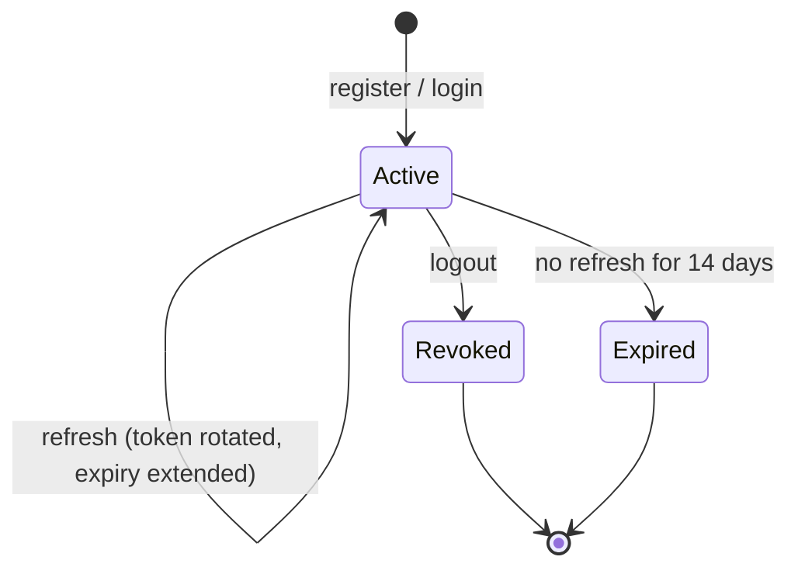

# Spec: Authentication & sessions

Status: **implemented (M1)** · Code: `backend/.../auth`, `backend/.../security`, `frontend/src/features/auth`

## Requirements

| ID | Requirement |
|---|---|
| AUTH-1 | A visitor can register with email, password, full name and role **STUDENT** or **TEACHER**. |
| AUTH-2 | `ADMIN` cannot be self-assigned (provisioned out-of-band). |
| AUTH-3 | Emails are unique, case-insensitive (stored lower-cased). |
| AUTH-4 | Passwords: 8–128 characters; stored only as a bcrypt hash. |
| AUTH-5 | A registered user can log in with email + password; failures do not reveal whether the email exists. |
| AUTH-6 | A user stays signed in across page reloads and browser restarts for up to 14 days of inactivity. |
| AUTH-7 | Each login creates a separate **session** (device); logout ends only that session. |
| AUTH-8 | A stolen refresh token stops working once the legitimate client has used it (rotation). |
| AUTH-9 | Disabled users cannot log in or refresh. |
| AUTH-10 | (M2) Registration stores the browser's IANA time zone (invalid ids fall back to UTC); heartbeats keep it current. Registration and logins count toward "logins per day". |

## Tokens

| | Access token | Refresh token |
|---|---|---|
| Format | JWT, HS256, signed with `VED_JWT_SECRET` | 256-bit random, base64url, opaque |
| Lifetime | 15 min (`ved.security.jwt.access-token-ttl`) | 14 days, sliding: renewed on each refresh (`ved.security.refresh-token.ttl`) |
| Where the client keeps it | Memory only (JS variable) | `ved_refresh` cookie: `HttpOnly`, `SameSite=Strict`, `Path=/api/auth`, `Secure` in prod |
| Server storage | none (stateless) | `user_sessions.refresh_token_hash` = SHA-256 hex |
| Claims | `iss=ved`, `sub=<userId>`, `name`, `roles=[ROLE]`, `iat`, `exp` | — |

## Endpoints

| Method & path | Auth | Request | Success |
|---|---|---|---|
| `POST /api/auth/register` | public | `{email, password, fullName, role, timeZone?}` | **201** `AuthResponse` + `Set-Cookie` |
| `POST /api/auth/login` | public | `{email, password}` | **200** `AuthResponse` + `Set-Cookie` |
| `POST /api/auth/refresh` | refresh cookie | — | **200** `AuthResponse` + rotated `Set-Cookie` |
| `POST /api/auth/logout` | refresh cookie (optional) | — | **204**, cookie cleared; idempotent |
| `GET /api/users/me` | Bearer | — | **200** `UserResponse` |

```jsonc
// AuthResponse
{
  "accessToken": "eyJ...",
  "tokenType": "Bearer",
  "expiresIn": 900,           // seconds
  "user": { "id": "uuid", "email": "a@b.c", "fullName": "…", "role": "STUDENT",
            "timeZone": "Asia/Kathmandu", "dailyGoalMinutes": 10, "createdAt": "…" }
}
```

Errors: `VALIDATION_FAILED`, `EMAIL_ALREADY_REGISTERED`, `INVALID_CREDENTIALS`,
`INVALID_REFRESH_TOKEN`, `UNAUTHENTICATED` (see [api-conventions.md](api-conventions.md)).

## Session lifecycle



## Client behaviour (frontend)

1. On app start, call `POST /auth/refresh`. Success → signed in; 401 → show login.
2. Attach the access token to API calls. On a 401, refresh **once** (a single in-flight refresh
   shared by all concurrent requests, since tokens rotate) and retry; if refresh fails, sign out.
3. Logout calls `POST /auth/logout` and drops the in-memory token.

## Security notes

- **CSRF:** the API authenticates with the `Authorization` header, which browsers don't attach
  automatically. The only cookie is the refresh cookie, scoped to `/api/auth` and `SameSite=Strict`,
  so cross-site requests can't use it. CSRF tokens are therefore disabled.
- **XSS:** the access token is never stored in `localStorage`; the refresh token is unreadable by JS.
- **Timing:** login always runs a bcrypt comparison, even for unknown emails.
- **Production must set:** `VED_JWT_SECRET` (≥ 32 random bytes), `VED_COOKIE_SECURE=true`, HTTPS.

## Not yet implemented (see roadmap)

Email verification, password reset, rate limiting / lockout on login, refresh-token **reuse
detection** (revoke the whole session when an old token is replayed), "active sessions" list
and remote logout, admin user management, OAuth/SSO (e.g. Google for schools).
