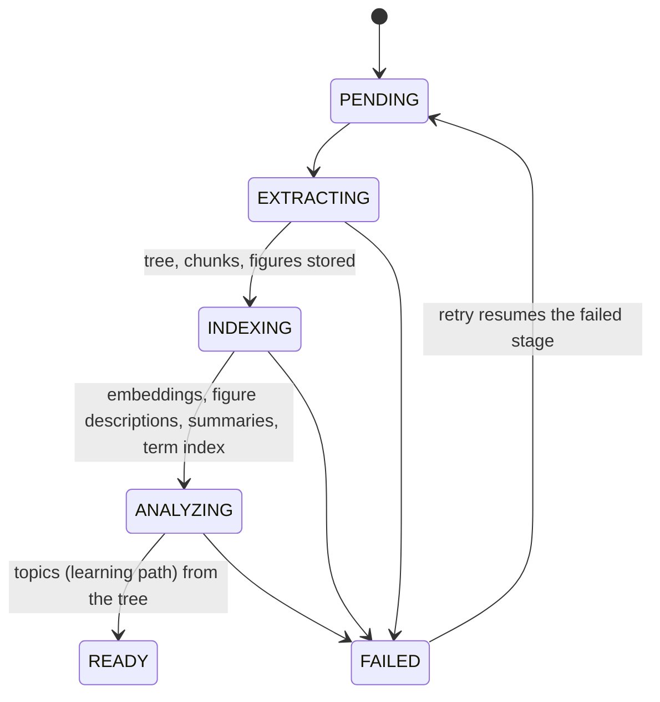

# Spec: Knowledge store (document tree, index, figures, retrieval)

Status: **implemented (M3), backend + inference**; the document **Preview** (reading view of the whole document
with per-section Expand / Revision notes) is built (`frontend/src/features/documents/DocumentPreview.tsx`); the rest of
the Read mode UI (tree navigation, search, ask) is **planned** · Code: `inference/.../parsing`, `inference/.../indexing`,
`backend/.../knowledge`, `backend/.../study/read`
Background: [RAG Architecture for Student Learning Platforms](../../RAG%20Architecture%20for%20Student%20Learning%20Platforms.pdf), [ADR-0009](../adr/0009-knowledge-store-tree-hybrid-index-figures.md)
Architecture (how it works, tunings, limitations): [document-parsing.md](../architecture/document-parsing.md),
[knowledge-storage.md](../architecture/knowledge-storage.md), [retrieval.md](../architecture/retrieval.md),
[backend-inference-integration.md](../architecture/backend-inference-integration.md)

## Problem

Until M2 a document was flattened into ~3.5k-character chunks, and every lesson/test passed raw chunk
text to the LLM. That loses the curriculum's structure (chapters → sections), drops every figure,
and can't answer "where does the book talk about X?" or write long-form notes efficiently.

## Goals

| ID | Requirement |
|---|---|
| KN-1 | Parse each document **once** into a navigable **tree**: document → chapter → section → subsection, with a stable hierarchical **index** (`2.3.1`) and page ranges. |
| KN-2 | Split each node's text into small **leaf chunks** (~150–250 tokens) that keep a link to their node (parent–child). |
| KN-3 | Extract **figures** (raster images *and* vector diagrams) with page, bounding box and caption, store them once, and link each to the node and chunk where it appears. Drop decorative images (logos, icons, backgrounds). |
| KN-4 | Describe each figure with a vision model (for search, alt text and LLM context, without sending pixels to the LLM again). |
| KN-5 | Maintain an **inverted index** for exact terms (Postgres full-text, GIN) and a **dense index** for meaning (pgvector, multimodal embeddings), both filterable by subtree (`path <@ '2.3'`). |
| KN-6 | Summarise every node bottom-up and extract **key terms**; key terms form a back-of-book **term index** (term → sections). |
| KN-7 | Retrieval is **hybrid** (keyword + vector, fused with RRF) with **small-to-big** expansion and figure attachment, so the LLM gets compact, structured context, never the whole document. |
| KN-8 | Generate **long-form answers** and **study notes** (per section, in an in-depth *Expand* or a condensed *Revision* style; chapter notes via map-reduce) that cite sections and embed the right figures inline. |
| KN-9 | Learn/Test (topics, lessons, questions) are built on the tree instead of flat chunks; lessons can show figures too. |

## Pipeline



Each stage is idempotent and resumable: extraction is skipped when the document already has extracted text
(stored in the same transaction as the tree); indexing only processes items that are still missing
descriptions / summaries / embeddings and commits per batch. Transient failures (everything except rejected input:
AI provider busy, out of quota or misconfigured) are retried automatically after
`sapio.documents.processing.auto-retry-delays`, but not before the AI's quota-reset hint; the user can also retry.
Details: [knowledge-storage.md](../architecture/knowledge-storage.md#pipeline-states-and-retries).

### 1. Extraction & structural parsing (inference, `POST /v1/extract`)

1. Every input is normalised to PDF (images become one-page PDFs).
2. Per page, the layout parser (PyMuPDF 4LLM layout model) yields typed **blocks** in reading order:
   `section-header`, `text`, `list-item`, `table`, `formula`, `caption`, `picture` (with bbox and
   image bytes; vector diagrams are rasterised). Running headers/footers are dropped.
   Pages with fewer than `parsing.native_min_chars` letters/digits in their text layer are OCR'd (RapidOCR in
   the layout path; Unlimited-OCR engines return markdown, without figures). On pages OCR'd by the layout path,
   figures are found by a **gap-with-ink** heuristic: tall bands between text blocks that still contain ink.
3. **Tree building**: heading levels come from the layout model's heading hierarchy, and explicit numbering
   (`Chapter 2` → level 1, `2.3 Title` → level 2) overrides them when most headings are numbered. The PDF
   outline (bookmarks) is not used. Documents with no detectable headings get one node per 5 pages
   ("Pages 1–5") so navigation still works.
   Node **path** = ordinal position (`2.3.1`, an `ltree`), node **label** = the document's own numbering
   when it has one (`Unit 4`, `2.3`), else the path.
4. **Leaf chunks**: blocks are packed per node into chunks of ~900 characters (max 1,400), never splitting
   a table or formula and never separating a caption from its figure; each chunk records its page range.
5. **Figures**: kept when ≥ 100 px on the short side, ≥ 1.2 % of the page area, aspect ≤ 6:1, not
   a small image (< 8 % of the page) repeated on ≥ 3 distinct pages (logos), not a background covering > 85 % of a
   text page, and at most 400 per document. A larger image repeated across pages is reused content (e.g. an
   architecture diagram on every slide that discusses it) and is kept once per section. Caption = the adjacent `caption` block. Images are re-encoded (PNG for line art, JPEG for
   photos, ≤ 1,600 px). All thresholds are `parsing.*` settings: see
   [document-parsing.md](../architecture/document-parsing.md#tuning-knobs-inferencesettingsyaml).

Response (camelCase JSON): `tree: {nodes[], chunks[], figures[]}` with string keys, `parentKey`,
`nodeKey`, `chunkKey`, `imageBase64`, plus the existing `markdown`, `segments`, page counts.

### 2. Indexing (backend orchestrates, inference computes)

| Step | Inference endpoint | Stored |
|---|---|---|
| Figure description + role | `POST /v1/index/figures` (Gemini vision, batched) | `description`, `kind`; `VISUAL` figures kept, `DECORATIVE` deleted, `TEXTUAL` (terminal output, code, text-only slides) deleted and replaced by an annotated transcript appended to their passage |
| Node summaries + key terms, bottom-up (leaves first, parents from child summaries) | `POST /v1/index/summaries` (batched by depth) | `summary`, `key_terms`, term index |
| Embeddings: chunks (breadcrumb + text), figures (image + caption + description) | `POST /v1/index/embed` (configured model, default `gemini-embedding-2`, 768-d, multimodal) | `embedding vector(768)` + `embedding_model` |

Vectors are only compared with vectors of the same `embedding_model`; after a model switch a document is
re-embedded in the background the first time it is searched
([knowledge-storage.md](../architecture/knowledge-storage.md#embedding-model-tracking)).

### 3. Analysis

The learning path's topics are chosen from the **tree** (labels, titles, summaries, key terms, page
ranges): no raw text. Each topic references one or more node ids.

## Data model (PostgreSQL + `ltree` + `pgvector`)

| Table | Key columns |
|---|---|
| `document_nodes` | `id`, `document_id`, `parent_id`, `path ltree`, `label`, `level`, `title`, `ordinal`, `page_from/to`, `summary`, `key_terms text[]` |
| `document_chunks` | `id`, `document_id`, `node_id`, `ordinal`, `content`, `page_from/to`, `search_config regconfig`, `tsv tsvector` (generated, **GIN**), `embedding vector(768)` (**HNSW**, cosine), `embedding_model` |
| `document_figures` | `id`, `document_id`, `node_id`, `chunk_id` (anchor), `ordinal`, `page`, `bbox`, `storage_key`, `mime`, `width/height`, `caption`, `description`, `kind`, `tsv` (caption + description, GIN), `embedding vector(768)` (HNSW), `embedding_model` |
| `document_terms` | `document_id`, `term`, `node_id`: the back-of-book term index |
| `study_notes` | `node_id` + `style` (`EXPAND` \| `REVISION`, unique together), `markdown`, `figure_ids`, `source_node_ids`, `model`, `created_at`: cached generated notes |

Figure files live in `DocumentStorage` (local disk today, key `yyyy/mm/dd/<uuid>.png|jpg`, referenced by
`storage_key`), never in the DB. Schema, indexes and consistency rules:
[knowledge-storage.md](../architecture/knowledge-storage.md).

## Retrieval

```
query ─┬─ keyword: ts_rank_cd(tsv, websearch_to_tsquery)    ─┐
       └─ vector:  embedding <=> embed(query, RETRIEVAL_QUERY) ─┴─ weighted RRF (keyword 1, vector 2, k=10) → top leaves
            → small-to-big: + neighbouring chunks (±1, same node) + the hit's node summary + breadcrumb
            → figures: anchored to retrieved chunks, plus figure search (keyword + vector, cosine ≥
              sapio.knowledge.retrieval.figure-min-similarity = 0.48): always on the search endpoint (up to 4),
              for questions only when they look visual (up to 3)
            → structured context (YAML-like) → LLM
```

Details, budgets and tunings: [retrieval.md](../architecture/retrieval.md).

Optional scope: `nodeId` restricts every query to the node's subtree (`path <@ :path`).

### Context injection format (to the LLM)

Rendered by the inference service (`prompts.render_context`):

```yaml
SECTIONS:
- id: "§2.3"                  # "§" + node path; cite as [§2.3]
  path: "Chapter 2 Cells › 2.3 Osmosis"
  pages: "14-15"
  summary: …
  passages:
    - …
FIGURES:
- id: "7f3a0c2e-…"            # figure UUID; embed as 
  section: "§2.3"
  caption: Figure 2.4: Osmosis in a plant cell
  description: Diagram showing water moving…
```

The service validates the output: unknown figure ids are removed, citations must reference provided
sections.

## Public API (backend, authenticated)

| Endpoint | Returns |
|---|---|
| `GET /api/documents/{id}/tree` | flat node list (`id, parentId, path, label, title, level, pageFrom, pageTo, figureCount, hasNotes`) |
| `GET /api/documents/{id}/content` | the whole document in reading order: `sections` (`id, parentId, path, label, title, level, pageFrom, pageTo, blocks, unit, revision, editedAt`, blocks as below) + one `figures` map (signed URLs); figures without a description are left out |
| `PUT /api/documents/{id}/sections/{nodeId}` `{title, markdown, revision}` | saves the learner's edit of a section (ADR-0014); returns the content as above. `markdown` places the section's own figures as `` (others: `400`); a figure left out is deleted. `revision` must be the section's current one, else `409 EDIT_CONFLICT`; document must be `READY` (else `409 INVALID_STATE`) |
| `GET /api/documents/{id}/nodes/{nodeId}` | node + breadcrumb + `blocks` in reading order (`{type: text, markdown}` / `{type: figure, figureId}`) + `figures` map |
| `GET /api/documents/{id}/search?q=&nodeId=&limit=` | hybrid hits: `{chunkId, nodeId, label, title, path, snippet (highlighted), pages, score}` + matching figures |
| `GET /api/documents/{id}/terms` | `[{term, nodes:[{id,label,title}]}]` |
| `GET /api/documents/{id}/nodes/{nodeId}/notes?style=EXPAND\|REVISION` | `{nodeId, style, scope ("section" \| "overview"), markdown, figures, sources, generatedAt, stale}`: generated once per style and cached; `style` defaults to `EXPAND`; `stale` = written before significant learner edits to the covered text (not regenerated automatically) |
| `POST /api/documents/{id}/nodes/{nodeId}/notes/rewrite?style=` | rewrites the notes from the current text (refreshing the summaries an overview builds on first); same response |
| `POST /api/documents/{id}/ask` `{question, nodeId?, history?}` | `{answer (markdown), grounded, sources:[{citation,nodeId,label,title,pages}], figures}`; `grounded=false` when the document does not cover the question |
| `GET /api/figures/{figureId}/image?exp=&sig=` | the image; **signed URL** (HMAC-SHA256, expiry = next full hour + `figure-url-ttl` 6 h), so `` works without auth headers and URLs are cacheable |

`figures` maps (`{figureId: {id, url, caption, description, kind, width, height, page, nodeId}}`) accompany every
markdown payload; markdown references figures as `figure:<id>`, and the client swaps in the signed URL.
Lessons gain the same `figures` map.

**Note styles.** `EXPAND` explains a section in depth, as a patient tutor would: complex ideas in small steps, why and
how (not just what), jargon in plain words, an example or analogy per abstract idea, ending with "Key terms".
`REVISION` condenses it to what must be remembered: terse headed bullet points, under a third of the source's length,
ending with a "Quick self-test" (3-5 questions, answers not given). Chapter (overview) notes of a style are reduced
from the children's notes of the same style. Notes generated before styles existed are `EXPAND`
(`V7__note_styles.sql`).
