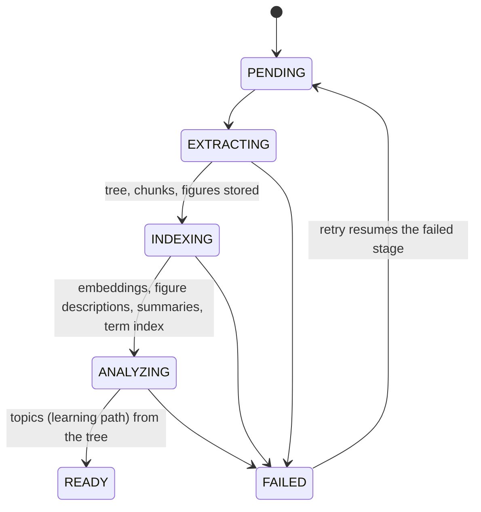

# Spec: Knowledge store (document tree, index, figures, retrieval)

Status: **implemented (M3)** · Code: `inference/.../parsing`, `inference/.../indexing`,
`backend/.../knowledge`, `backend/.../study/read`, `frontend/src/features/read`
Background: [RAG Architecture for Student Learning Platforms](../../RAG%20Architecture%20for%20Student%20Learning%20Platforms.pdf), [ADR-0009](../adr/0009-knowledge-store-tree-hybrid-index-figures.md)

## Problem

Until M2 a document was flattened into ~3.5k-character chunks, and every lesson/test passed raw chunk
text to the LLM. That loses the curriculum's structure (chapters → sections), drops every figure,
and can't answer "where does the book talk about X?" or write long-form notes efficiently.

## Goals

| ID | Requirement |
|---|---|
| KN-1 | Parse each document **once** into a navigable **tree**: document → chapter → section → subsection, with a stable hierarchical **index** (`2.3.1`) and page ranges. |
| KN-2 | Split each node's text into small **leaf chunks** (~150–250 tokens) that keep a link to their node (parent–child). |
| KN-3 | Extract **figures** (raster images *and* vector diagrams) with page, bounding box and caption, store them once, and link each to the node and chunk where it appears. Drop decorative images (logos, icons, backgrounds). |
| KN-4 | Describe each figure with a vision model (for search, alt text and LLM context, without sending pixels to the LLM again). |
| KN-5 | Maintain an **inverted index** for exact terms (Postgres full-text, GIN) and a **dense index** for meaning (pgvector, multimodal embeddings), both filterable by subtree (`path <@ '2.3'`). |
| KN-6 | Summarise every node bottom-up and extract **key terms**; key terms form a back-of-book **term index** (term → sections). |
| KN-7 | Retrieval is **hybrid** (keyword + vector, fused with RRF) with **small-to-big** expansion and figure attachment, so the LLM gets compact, structured context, never the whole document. |
| KN-8 | Generate **long-form answers** and **study notes** (per section; chapter notes via map-reduce) that cite sections and embed the right figures inline. |
| KN-9 | Learn/Test (topics, lessons, questions) are built on the tree instead of flat chunks; lessons can show figures too. |

## Pipeline



Each stage is idempotent and resumable: extraction is skipped when the tree exists; indexing only
processes items that are still missing embeddings / descriptions / summaries.

### 1. Extraction & structural parsing (inference, `POST /v1/extract`)

1. Every input is normalised to PDF (images become one-page PDFs).
2. Per page, the layout parser (PyMuPDF 4LLM layout model) yields typed **blocks** in reading order:
   `section-header`, `text`, `list-item`, `table`, `formula`, `caption`, `picture` (with bbox and
   image bytes; vector diagrams are rasterised). Running headers/footers are dropped.
   Pages without a text layer are OCR'd (RapidOCR in the layout path; Unlimited-OCR engines return
   markdown). On OCR'd pages, figures are found by a **gap-with-ink** heuristic: tall regions between
   text blocks that contain ink, or regions directly above a `Figure …` caption.
3. **Tree building**: heading levels come from the PDF outline (bookmarks) when present, otherwise from
   heading font hierarchy, and explicit numbering (`2.3 Title` → level 2) refines them. Documents with no
   detectable headings get one node per ~5 pages ("Pages 1–5") so navigation still works.
   Node **path** = ordinal position (`2.3.1`, an `ltree`), node **label** = the document's own numbering
   when it has one (`Unit 4`, `2.3`), else the path.
4. **Leaf chunks**: blocks are packed per node into chunks of ~600–1,000 characters, never splitting a
   table or formula; each chunk records its page range.
5. **Figures**: kept when ≥ 120 px on the short side, ≥ 1.5 % of the page area, aspect ≤ 6:1, not
   repeated on ≥ 3 pages (logos), and not a full-page background behind text. Caption = the adjacent
   `caption` block. Images are re-encoded (PNG for line art, JPEG for photos, ≤ 1,600 px).

Response (camelCase JSON): `tree: {nodes[], chunks[], figures[]}` with string keys, `parentKey`,
`nodeKey`, `chunkKey`, `imageBase64`, plus the existing `markdown`, `segments`, page counts.

### 2. Indexing (backend orchestrates, inference computes)

| Step | Inference endpoint | Stored |
|---|---|---|
| Figure description + educational filter | `POST /v1/index/figures` (Gemini vision, batched) | `description`, `kind`; non-educational figures deleted |
| Node summaries + key terms, bottom-up (leaves first, parents from child summaries) | `POST /v1/index/summaries` (batched by depth) | `summary`, `key_terms`, term index |
| Embeddings: chunks (breadcrumb + text), figures (image + caption) | `POST /v1/index/embed` (`gemini-embedding-2`, 768-d, multimodal) | `embedding vector(768)` |

### 3. Analysis

The learning path's topics are chosen from the **tree** (labels, titles, summaries, key terms, page
ranges): no raw text. Each topic references one or more node ids.

## Data model (PostgreSQL + `ltree` + `pgvector`)

| Table | Key columns |
|---|---|
| `document_nodes` | `id`, `document_id`, `parent_id`, `path ltree`, `label`, `level`, `title`, `ordinal`, `page_from/to`, `summary`, `key_terms text[]` |
| `document_chunks` | `id`, `document_id`, `node_id`, `ordinal`, `content`, `page_from/to`, `search_config regconfig`, `tsv tsvector` (generated, **GIN**), `embedding vector(768)` (**HNSW**, cosine) |
| `document_figures` | `id`, `document_id`, `node_id`, `chunk_id` (anchor), `ordinal`, `page`, `bbox`, `storage_key`, `mime`, `width/height`, `caption`, `description`, `kind`, `tsv` (GIN), `embedding vector(768)` |
| `document_terms` | `document_id`, `term`, `node_id`: the back-of-book term index |
| `study_notes` | `node_id` (unique), `markdown`, `model`: cached generated notes |

Figure files live in `DocumentStorage` (`figures/<documentId>/<figureId>.<ext>`), never in the DB.

## Retrieval

```
query ─┬─ keyword: ts_rank_cd(tsv, websearch_to_tsquery)    ─┐
       └─ vector:  embedding <=> embed(query, RETRIEVAL_QUERY) ─┴─ RRF (k=60) → top leaves
            → small-to-big: + neighbouring chunks + parent node summary + breadcrumb
            → figures: linked to retrieved chunks/nodes, plus vector search on figures for visual asks
            → structured context (YAML-like) → LLM
```

Optional scope: `nodeId` restricts every query to the node's subtree (`path <@ :path`).

### Context injection format (to the LLM)

```yaml
sections:
  - id: "§2.3"          # cite as [§2.3]
    path: "Chapter 2 › 2.3 Osmosis"
    pages: "14-15"
    summary: "…"
    passages: ["…", "…"]
figures:
  - id: "fig_7f3a…"     # embed as 
    section: "§2.3"
    caption: "Figure 2.4: Osmosis in a plant cell"
    description: "Diagram showing water moving…"
```

The service validates the output: unknown figure ids are removed, citations must reference provided
sections.

## Public API (backend, authenticated)

| Endpoint | Returns |
|---|---|
| `GET /api/documents/{id}/tree` | flat node list (`id, parentId, path, label, title, level, pageFrom, pageTo, figureCount, hasNotes`) |
| `GET /api/documents/{id}/nodes/{nodeId}` | node + breadcrumb + `blocks` in reading order (`{type: text, markdown}` / `{type: figure, figureId}`) + `figures` map |
| `GET /api/documents/{id}/search?q=&nodeId=&limit=` | hybrid hits: `{chunkId, nodeId, label, title, path, snippet (highlighted), pages, score}` + matching figures |
| `GET /api/documents/{id}/terms` | `[{term, nodes:[{id,label,title}]}]` |
| `GET /api/documents/{id}/nodes/{nodeId}/notes` | `{nodeId, markdown, figures, sources}`: generated once and cached |
| `POST /api/documents/{id}/ask` `{question, nodeId?, history?}` | `{answer (markdown), sources:[{nodeId,label,title,pages}], figures}` |
| `GET /api/figures/{figureId}/image?exp=&sig=` | the image; **signed URL** (HMAC, 6 h), so `` works without auth headers |

`figures` maps (`{figureId: {url, caption, description, width, height}}`) accompany every
markdown payload; markdown references figures as `figure:<id>`, and the client swaps in the signed URL.
Lessons gain the same `figures` map.
