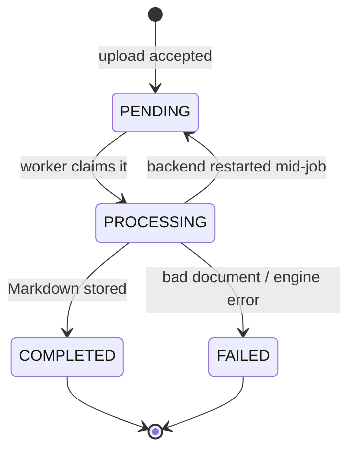

# Spec: Document to text (OCR)

Status: **implemented (M1)** · Code: `backend/.../document`, `inference/`, `frontend/src/features/documents`

## Purpose

Any signed-in user uploads a scanned page, photo or PDF and gets back editable **Markdown**.
This is the platform's first feature and the base for later ones: digitising handwritten
homework, importing worksheets into assignments, grading support.

## Requirements

| ID | Requirement |
|---|---|
| OCR-1 | Accept PDF, PNG, JPEG, WEBP, TIFF (multi-page) and BMP up to **25 MB**. |
| OCR-2 | The file type comes from the extension and must match the file's magic bytes; the client's Content-Type is ignored. |
| OCR-3 | Upload returns immediately (202); conversion runs in the background. |
| OCR-4 | The user can see status: `PENDING → PROCESSING → COMPLETED / FAILED`, with a readable reason on failure. |
| OCR-5 | The result can be viewed (rendered and raw), copied, and downloaded as `<original-name>.md`. |
| OCR-6 | Users only ever see and delete their own documents. |
| OCR-7 | Documents interrupted by a backend restart are resumed automatically. |
| OCR-8 | PDFs up to **200 pages** (inference `VED_INFERENCE_MAX_PAGES`). |
| OCR-9 | The OCR engine can be changed by configuration, without changing the backend or UI. |

## Status lifecycle



## Endpoints

| Method & path | Success | Notes |
|---|---|---|
| `POST /api/documents` (multipart, field `file`) | **202** `DocumentResponse` | `UNSUPPORTED_FILE_TYPE` 415, `FILE_TOO_LARGE` 413, `VALIDATION_FAILED` 400 (empty file) |
| `GET /api/documents?page=&size=` | **200** page of `DocumentResponse` | newest first |
| `GET /api/documents/{id}` | **200** `DocumentResponse` | poll this every ~2 s while not terminal |
| `GET /api/documents/{id}/result` | **200** `{id, format: "markdown", content}` | `RESULT_NOT_READY` 409 before completion |
| `GET /api/documents/{id}/result/download` | **200** `text/markdown`, `Content-Disposition: attachment` | |
| `DELETE /api/documents/{id}` | **204** | deletes record and stored file |

```jsonc
// DocumentResponse
{
  "id": "uuid",
  "filename": "chapter-3.pdf",
  "contentType": "application/pdf",
  "sizeBytes": 183422,
  "status": "COMPLETED",
  "engine": "unlimited-ocr",   // null until completed
  "pageCount": 12,              // null until completed
  "errorMessage": null,         // set when FAILED
  "createdAt": "…",
  "completedAt": "…"
}
```

## Output format

- Markdown. Pages are separated by a horizontal rule (`\n\n---\n\n`).
- With **Unlimited-OCR**, headings, lists, tables and formulas are kept as Markdown/LaTeX;
  layout-detection markers (`<|det|>…<|/det|>`) are removed.
- With the **RapidOCR** fallback, the output is plain text grouped into lines and paragraphs
  (no headings or tables).

## Processing & limits

- Backend worker pool: 2–4 threads, queue 200 (`ved.documents.processing.*`). When the queue is
  full a document stays `PENDING` and is picked up on the next restart (see roadmap).
- Backend → inference read timeout: 20 min (`ved.inference.read-timeout`).
- Inference runs `VED_INFERENCE_MAX_CONCURRENCY` (default 1) conversions at a time.
- Files are stored at `ved.documents.storage-dir/yyyy/MM/dd/<uuid>.<ext>`; results in
  `documents.result_markdown`.

## Not yet implemented (see roadmap)

Retry button for failed documents, per-user quotas, page-range selection, DOCX export,
streaming partial results, editing the result, original-file preview next to the text.
