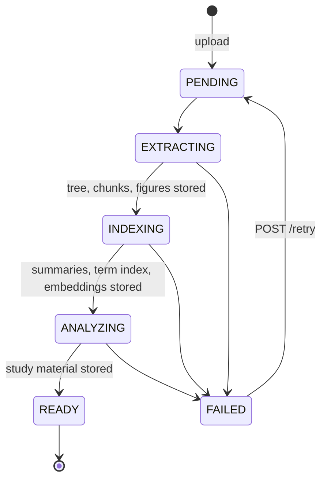
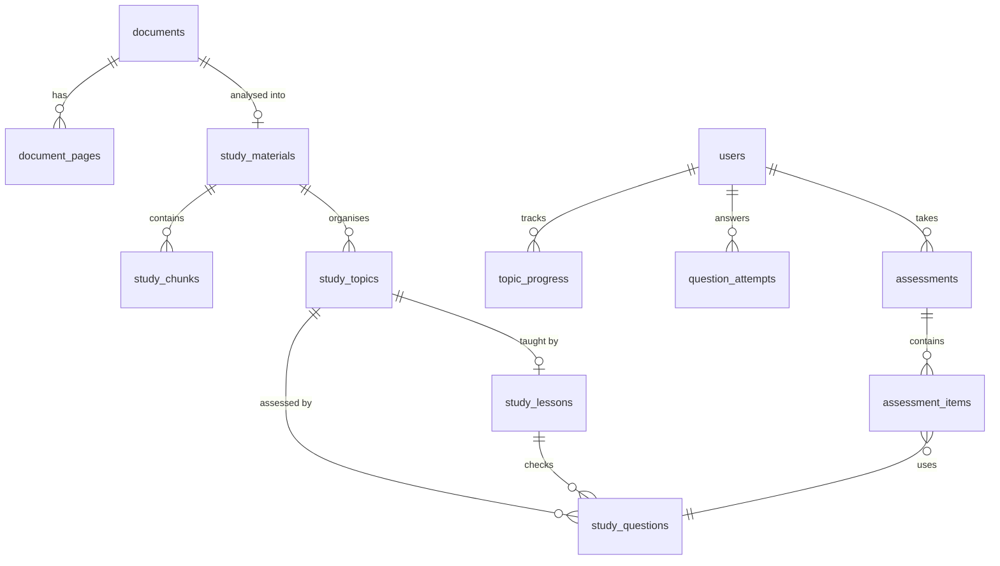

# Spec: Study a document (Learn & Test)

Status: **implemented (M2)** · Code: `backend/.../study`, `inference/.../study`, `frontend/src/features/study`

## Product concept

A user uploads educational material (syllabus, textbook PDF, lecture notes, handout, scan).
Ved extracts the text (native PDF text when the page has a text layer, OCR otherwise) and turns
it into a **study material**: the document split into source *chunks*, organised into an ordered
list of *topics*. Once the material is ready, the user picks a mode:

- **Learn**: an AI tutor teaches topic by topic: concept explanations, worked examples and
  analogies built **only from the document**, with comprehension checks between sections and a
  "ask the tutor" box.
- **Test my knowledge**: an assessment with AI-generated questions grounded in the material.
  Each answer gets immediate feedback; at the end the user gets a report with score,
  per-topic performance, weak areas and next steps.

Both modes read the **same study material** (chunks + topics). Topics link to the chunks they
were derived from, and lessons and questions are generated only from those chunks.

## Requirements

| ID | Requirement |
|---|---|
| STU-1 | Extraction is per page: pages with a usable text layer use native text; others are OCR'd. |
| STU-2 | After extraction, a study material is built: title, summary, language, chunks, 3–12 ordered topics. |
| STU-3 | Every topic references ≥ 1 source chunk. Lessons/questions only receive their topics' chunks. |
| STU-4 | Lessons are generated on first open and cached (content is shared, per-learner progress is separate). |
| STU-5 | Comprehension checks and assessment questions are graded **server-side**; correct answers are never sent before the learner answers. |
| STU-6 | Multiple-choice and true/false are graded deterministically; short answers are graded by the LLM against the reference answer and source. |
| STU-7 | Generated content uses the document's language. |
| STU-8 | A finished assessment has a report: score, counts, per-topic score + level, AI summary, strengths, weak areas with advice, next steps. |
| STU-9 | Learning actions emit activity events (feeding XP, streaks and analytics, see [progress.md](progress.md)). |
| STU-10 | Users only access materials of documents they own (404 otherwise). |
| STU-11 | Every lesson opens with a **warm-up** (pretest) question and ends with an **explain-it-back** short-answer check ([learning-science.md](../architecture/learning-science.md)). |
| STU-12 | Answers may carry the learner's **confidence**; reports show calibration. |
| STU-13 | Every answered question becomes a **spaced-repetition review card** (Leitner). |
| STU-14 | Topics expose a per-learner **mastery** score; one **recommended next step** is computed across all materials. |
| STU-15 | Assessment questions are **interleaved** across topics. |

## Document pipeline



The pipeline resumes where it stopped: if pages were already extracted, a retry or restart only
re-runs analysis.

## Public API (backend)

All endpoints require `Authorization: Bearer`. Errors follow [api-conventions.md](api-conventions.md).
New error codes: `MATERIAL_NOT_READY` (409), `ALREADY_ANSWERED` (409), `ASSESSMENT_CLOSED` (409),
`AI_UNAVAILABLE` (503, generation failed; safe to retry).

### Documents (changes)

`DocumentResponse` gains:

```jsonc
{
  "status": "PENDING | EXTRACTING | INDEXING | ANALYZING | READY | FAILED",
  "title": "Introduction to Microeconomics",  // AI-derived, null until READY
  "textPages": 10,                             // pages using native text, null until extracted
  "ocrPages": 2                                // pages that were OCR'd, null until extracted
  // …existing fields
}
```

- `GET /api/documents/{id}/result` works once text is extracted (status `ANALYZING` or `READY`).
- `POST /api/documents/{id}/retry`: **202** `DocumentResponse`; only for `FAILED` (else `409 VALIDATION_FAILED`).

### Study material

`GET /api/documents/{id}/material` → **200** (409 `MATERIAL_NOT_READY` unless READY)

```jsonc
{
  "documentId": "uuid",
  "title": "Introduction to Microeconomics",
  "summary": "Markdown paragraph describing the material",
  "language": "en",
  "kind": "SYLLABUS | TEXTBOOK | LECTURE_NOTES | HANDOUT | OTHER",
  "topics": [
    {
      "id": "uuid",
      "position": 1,
      "title": "Supply and demand",
      "summary": "One or two sentences",
      "keyConcepts": ["demand curve", "equilibrium price"],
      "difficulty": "INTRO | CORE | ADVANCED",
      "status": "NOT_STARTED | IN_PROGRESS | COMPLETED",
      "completedAt": null,
      "mastery": 0.65,           // 0..1, null until the learner answered a question on this topic
      "recommended": true        // exactly one topic is recommended next (or none when all mastered)
    }
  ],
  "stats": { "topicCount": 6, "completedTopics": 2, "assessmentsCompleted": 1, "bestScore": 0.8,
             "reviewsDue": 3 }
}
```

### Learn

`GET /api/topics/{topicId}/lesson` → **200**. Generates the lesson on first call (may take
10–30 s) and marks the topic `IN_PROGRESS` for the caller.

```jsonc
{
  "topicId": "uuid",
  "title": "Supply and demand",
  "sections": [
    { "index": 0, "kind": "CONCEPT | EXAMPLE | ANALOGY | SUMMARY", "heading": "What is demand?", "body": "markdown" }
  ],
  "keyTakeaways": ["…"],
  "checks": [
    {
      "id": "uuid",              // question id
      "afterSection": 0,         // show after this section index; -1 = warm-up before the first section
      "type": "MULTIPLE_CHOICE | TRUE_FALSE | SHORT_ANSWER",   // SHORT_ANSWER = explain-it-back
      "prompt": "…",
      "options": ["…", "…"],
      "lastAnswer": null          // AnswerResult of the caller's latest attempt, or null
    }
  ],
  "status": "IN_PROGRESS | COMPLETED"
}
```

`POST /api/questions/{questionId}/answer` (lesson checks; re-attempts allowed) → **200** `AnswerResult`

```jsonc
// request: exactly one of optionIndex / text depending on question type; confidence optional
{ "optionIndex": 1, "confidence": "LOW | MEDIUM | HIGH" }   // or { "text": "free-form answer", "confidence": … }

// AnswerResult
{
  "questionId": "uuid",
  "verdict": "CORRECT | PARTIAL | INCORRECT",
  "score": 1.0,                   // 0..1
  "selectedOptionIndex": 1,       // null for SHORT_ANSWER
  "answerText": null,             // null unless SHORT_ANSWER
  "correctOptionIndex": 1,        // null for SHORT_ANSWER
  "referenceAnswer": null,        // model answer for SHORT_ANSWER
  "explanation": "Why the correct answer is correct (grounded in the source)",
  "feedback": "Personal feedback on this answer (may equal explanation for choice questions)",
  "confidence": "HIGH",           // echoed, null if not given
  "nextReviewAt": "2026-10-10T…"  // when this question comes back for spaced review
}
```

Mastery of a topic = recency-weighted mean score of the learner's attempts on its questions (last 10
attempts, weights 1.0, 0.85, 0.85², …). "Recommended" topic = first topic (in order) that is
in progress, else first not started, else the lowest-mastery topic below 0.8.

`POST /api/topics/{topicId}/complete` → **200** `{ "topicId", "status": "COMPLETED", "completedAt" }` (idempotent).

`POST /api/topics/{topicId}/ask` → **200**

```jsonc
// request (history: most recent last, max 10 turns, client-held)
{ "question": "Why does the curve slope down?", "history": [{ "role": "user | tutor", "text": "…" }] }
// response
{ "answer": "markdown", "grounded": true }   // grounded=false: the document doesn't cover it
```

### Spaced review

Every first answer to a question (lesson check, assessment item, review) creates or updates the
learner's review card for that question. Leitner boxes 1–5 with intervals **1, 3, 7, 16, 35 days**:
correct → next box; partial → same box; incorrect → box 1, due again in **10 minutes**.

`GET /api/reviews/summary` → **200** `{ "dueNow": 3, "dueToday": 5, "total": 42 }`

`GET /api/reviews/due?limit=10&documentId=` (documentId optional) → **200**

```jsonc
{ "items": [ { "question": { "id", "type", "prompt", "options", "topicId", "topicTitle" },
               "documentId": "uuid", "documentTitle": "…", "box": 2, "dueAt": "…" } ] }
```

Items are interleaved across topics/documents. `POST /api/reviews/{questionId}/answer` (same body as
question answers) → **200** `AnswerResult` (with the new `nextReviewAt`). 409 `NOT_DUE` if the card
isn't due yet.

### Recommended next step

`GET /api/study/next-step` → **200** (one action, ordered by learning value)

```jsonc
{
  "kind": "REVIEW | CONTINUE_TOPIC | START_TOPIC | TAKE_TEST | UPLOAD",
  "documentId": "uuid|null", "topicId": "uuid|null",
  "title": "Review 4 cards", "reason": "Spaced review keeps what you learned from fading",
  "estimatedMinutes": 2
}
```

Priority: due reviews → in-progress topic → next topic of the most recently studied material →
test when all topics are completed and no assessment yet → upload.

### Test my knowledge

`POST /api/documents/{id}/assessments` → **201** `Assessment` (generation is synchronous, 10–40 s)

```jsonc
{ "questionCount": 10, "difficulty": "EASY | MIXED | HARD", "topicIds": ["uuid"] }  // topicIds optional = all
```

`GET /api/documents/{id}/assessments` → **200** `AssessmentSummary[]` (newest first)

```jsonc
{ "id", "status": "IN_PROGRESS | COMPLETED", "difficulty", "questionCount", "answeredCount",
  "score": 0.7, "createdAt", "completedAt" }   // score null until completed
```

`GET /api/assessments/{id}` → **200** `Assessment`

```jsonc
{
  "id": "uuid", "documentId": "uuid", "documentTitle": "…",
  "status": "IN_PROGRESS | COMPLETED", "difficulty": "MIXED",
  "questionCount": 10, "answeredCount": 3, "score": null,
  "createdAt": "…", "completedAt": null,
  "items": [
    {
      "position": 1,
      "question": {
        "id": "uuid", "type": "MULTIPLE_CHOICE | TRUE_FALSE | SHORT_ANSWER",
        "prompt": "…", "options": ["…"],          // options empty for SHORT_ANSWER
        "topicId": "uuid", "topicTitle": "…"
      },
      "answer": null                                // AnswerResult once answered
    }
  ],
  "report": null                                    // AssessmentReport once COMPLETED
}
```

`POST /api/assessments/{id}/items/{position}/answer` → **200** `AnswerResult`
(one attempt per item: `409 ALREADY_ANSWERED`; `409 ASSESSMENT_CLOSED` once completed).

`POST /api/assessments/{id}/complete` → **200** `Assessment` with `report`. Unanswered items count
as skipped (score 0) and are scheduled for spaced review like misses (so they come back). Idempotent.

```jsonc
// AssessmentReport
{
  "score": 0.72, "correctCount": 6, "partialCount": 1, "incorrectCount": 2, "skippedCount": 1,
  "topics": [ { "topicId", "title", "questionCount": 3, "score": 0.33, "level": "STRONG | DEVELOPING | WEAK" } ],
  "summary": "markdown, 2–4 sentences",
  "strengths": ["…"],
  "weakAreas": [ { "topicId": "uuid|null", "title": "…", "advice": "…" } ],
  "nextSteps": ["…"],
  "calibration": { "confidentCorrect": 5, "confidentIncorrect": 1, "unsureCorrect": 2, "unsureIncorrect": 1 }
}
```

`calibration` counts answers by confidence (HIGH/MEDIUM = confident, LOW = unsure); answers
without confidence are left out.

Topic level: score ≥ 0.8 → STRONG, ≥ 0.5 → DEVELOPING, else WEAK. The narrative part (`summary`,
`strengths`, `weakAreas`, `nextSteps`) comes from the LLM; if that call fails, the report is stored
with a deterministic fallback narrative.

## Data model



Content (`study_*`) is separate from per-learner state (`topic_progress`, `question_attempts`,
`assessments`), so a material can later be shared with a whole class.

## Generation rules (inference)

- Source structure comes from the knowledge store ([knowledge.md](knowledge.md)): a document tree with
  small leaf chunks (~900 characters), node summaries and key terms.
- Outline: the LLM sees only the **tree** (label, title, level, pages, summary truncated to
  `study.outline_summary_chars`, key terms) plus a ~1,500-character text sample for language/kind
  detection, never the raw text. Topics reference node ids (validated; topics without valid nodes are
  dropped); at most `study.max_topics` (12).
- Context: lessons, questions and grading receive **structured sections** (`§id`, breadcrumb, pages,
  summary, passages) and figures assembled from the topic's subtrees in document order, up to the
  per-use budget in `ved.study.context.*` (lesson 24k characters / 6 figures, questions 12k, grade 6k,
  tutor 10k / 2 figures; see [configuration.md](../guides/configuration.md)).
- Lesson: 3–6 sections mixing CONCEPT / EXAMPLE / ANALOGY, ending with
  SUMMARY; one warm-up question (`afterSection: -1`), 2–3 multiple-choice/true-false checks after
  sections, and one SHORT_ANSWER "explain it back" check after the last section.
- Questions: distributed across the selected topics; mix of types by difficulty; prompts already
  asked in the user's previous assessments of the same document are passed as "avoid" hints.
- All prompts tell the model to use only the provided source, to answer in the material's language,
  and to say so when something isn't covered.
- Feedback tone (grading, reports): growth-mindset: specific, about strategy and content, encouraging,
  never about the learner's ability. Reports list strengths before weak areas.
